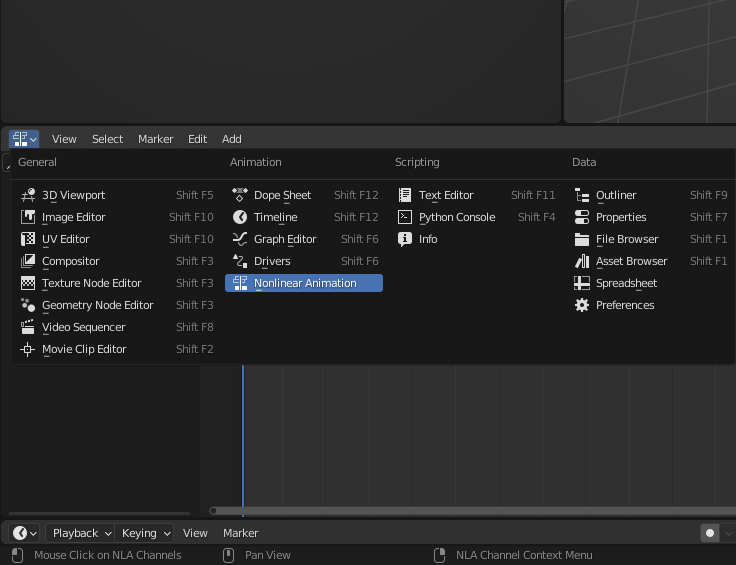
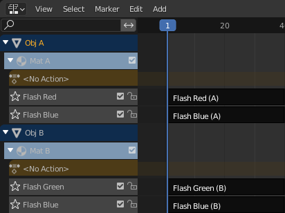
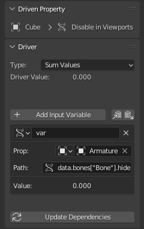

# Introduction

BRRES files support 6 distinct types of animation. Only 5 are used in New Super Mario Bros. Wii (the unused format being SHP), so only these 5 are currently supported by BerryBush. These 5 formats can be categorized into 2 main groups: armature animations ([CHR](#chr), [VIS](#vis)) and material animations ([CLR](#clr), [PAT](#pat), [SRT](#srt)). An **armature animation** is applied to a single armature, and contains animation data for every animated bone. A **material animation** is applied to a whole model, and contains animation data for every animated material.

Both groups rely on the NLA editor for import and export. Basic familiarity with it is assumed throughout this page.

When a model is exported, every NLA track on every material and armature object is checked for possible conversion to BRRES. The first strip on the NLA track must be an action strip. Then, if that strip corresponds to some BRRES format, the export process begins for it. A single action can correspond to multiple formats, and BerryBush will automatically split up the animation data.

To see working animation setups, you can import animated models from the original game and check them out in the NLA editor.

If multiple materials or multiple armature objects have tracks with the same name, their corresponding animations are **merged**. For instance, if two materials both have a track called `Mat Anim`, one material animation called `Mat Anim` will be created with data for both materials. If two armature objects both have a track called `Arm Anim`, one armature animation called `Arm Anim` will be created with data for the union of all of their bones.[*](#footnote-1)

If a single material or object has multiple tracks with the same name, only the bottommost one is used and the rest are ignored.

The following example would lead to the creation of three material animations[**](#footnote-2) called `Flash Red` (with data for Mat A), `Flash Green` (with data for Mat B), and `Flash Blue` (with data for both materials):

Notice how the materials could have different actions with different data for `Flash Blue`, but they'll still be grouped together in the resulting BRRES animation.

When an NLA strip is used to export an animation, most of its properties and the properties of its track (except for the name) are ignored entirely. The exported animation simply reflects the strip's first action, **regardless of the strip's position or length**. The action's Frame Range and Cyclic Animation settings are used exclusively to determine how the exported animation should be evaluated. If multiple animations are merged (different armature objects or materials have tracks with shared names), the minimum start frame and maximum end frame are used. Conflicting Cyclic Animation values will result in one being chosen arbitrarily. All NLA strips beyond the first one on a track are always ignored. This system may be reworked if it's found to have issues, but it was chosen for its simplicity and it should have everything necessary.

<a name="footnote-1">[*](#footnote-1-ref)</a>Note that if a merge is attempted for bone animations that conflict with one another, BerryBush will pick one arbitrarily to use, which could lead to undesired behavior. Ensure when merging armature animations that the animations you're trying to merge don't have any such conflicts (e.g., one armature has a bone called `Head` that's looking all around while the other has a bone called `Head` that's looking straight ahead).

<a name="footnote-2">[**](#footnote-2-ref)</a>Actually, as many as 9 animations may be created because of the 3 different material animation formats. If, for example, Mat A's `Flash Blue` has CLR data, while Mat B's `Flash Blue` has PAT and SRT data, then 3 different `Flash Blue` animations (one for each format) will be created. However, if both animations have CLR data, that will be merged into one CLR animation with data for both materials. Additionally, if none of them have any data corresponding to BRRES formats, there may not be any animations exported at all. The point is, you can think of animations corresponding to NLA tracks with the same name as being merged and then split into the different formats.

# Armature Animation Formats

## CHR

CHR animations are set up by animating bone movement (translation, rotation, or scaling). This is the most commonly used format in NSMBW, underpinning most 3D animation. It's currently the only animation format that exports properly when drivers are used. For now, **F-Curves must be used directly to export all other types of animation**.

Constraints are also incorporated into CHR animations, but note that the conversion from Blender constraints to BRRES animation comes with fundamental limitations which can lead to inaccurate export without an automatic solution in some cases. [[ This YouTube video | https://www.youtube.com/watch?v=1Xm1h700uhk ]] goes into great detail on the subject and provides a lot of helpful tips for overcoming these limitations to make high quality exports, and much of the insight here can be applied directly to BRRES.

Animations are always imported accurately, so to verify that they were exported correctly without having to load them ingame, it may help to re-import them in Blender and play them back. **BerryBush is more accurate than BrawlBox/BrawlCrate for viewing CHR animations,**[*](#footnote-3) which is why this is the recommended workflow. This is strongly recommended when exporting animated models that make use of complex bone relationships (**especially if non-uniform scaling - AKA squash & stretch - is involved**).

<a name="footnote-3">[*](#footnote-3-ref)</a>This is due to a BRRES feature called **Segment Scale Compensate** which BrawlCrate doesn't currently take into account. To see this in action, check out the `throw` animation in the Spike model (`Object/gabon.arc`).

## VIS

VIS animations are set up by animating the visibility of bones. By default, this has no real effect, but if you use drivers to link object viewport visibility to bone visibility, BerryBush will recognize this and then when exported bones are hidden, their corresponding objects will be hidden as well. This is used in NSMBW for effects such as the clown car's varying 3D facial expressions.

Here's an example of a working driver setup that will be detected by BerryBush. "Cube" will get its visibility from "Bone", and then animating the visibility of "Bone" will affect "Cube" as well:

# Material Animation Formats

## CLR

CLR animations are set up by animating the contents of certain color registers. These include the registers in [[ lighting channels | Materials#lighting-channels ]] and the [[ standard & constant registers | Materials#color-registers ]] on every material. This is used in NSMBW for effects such as bosses flashing red when they take damage.

## PAT

PAT animations are set up by animating textures' active image slots under the [[ Animation Slots | Materials#images ]] tab of the **Texture > Image** interface, allowing images to be swapped out for one another. This is used in NSMBW for effects such as changing power-up outfits and facial expressions.

## SRT

SRT animations are set up by animating [[ texture transforms | Materials#transform ]] (translation, rotation, or scaling). This is used in NSMBW for effects such as moving water and clouds.