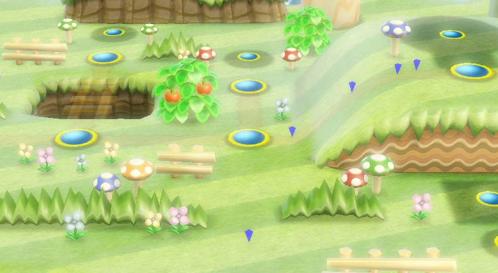

# Introduction

**Bloom** makes the bright parts of the image glow into their surroundings. The `.bblm` format comes from Mario Kart Wii, which uses it in every course.

**Be advised that NSMBW itself has no bloom.** It never loads `.bblm` files, so a bloom file only does something in a mod that adds the bloom code of Mario Kart Wii to the game. BerryBush loads `bloom/<Set>.bblm` together with the lighting set of the same name, and draws it exactly like Mario Kart Wii does, at the sizes of the game's 640 by 456 frame buffer.

This is how the bloom is drawn:

1. The image is copied at a quarter of its size (or half of it, with **Half Resolution**).
2. Only what's brighter than the **Threshold** is kept. Each pixel keeps its own color, scaled by twice how far its brightness lies above the threshold.
3. That's blurred, and optionally blurred again, much wider, at half that size (**Wide Blur**).
4. The two blurs are mixed by their **Weights**, tinted with the **Color**, and put over the image with the **Blend**.

# Adding Bloom to a Lighting Set

Check the checkbox in the header of the **Bloom** panel. This gives the lighting set a `.bblm`, which gets saved as `bloom/<Set>.bblm`. Unchecking it removes the bloom from the set again.

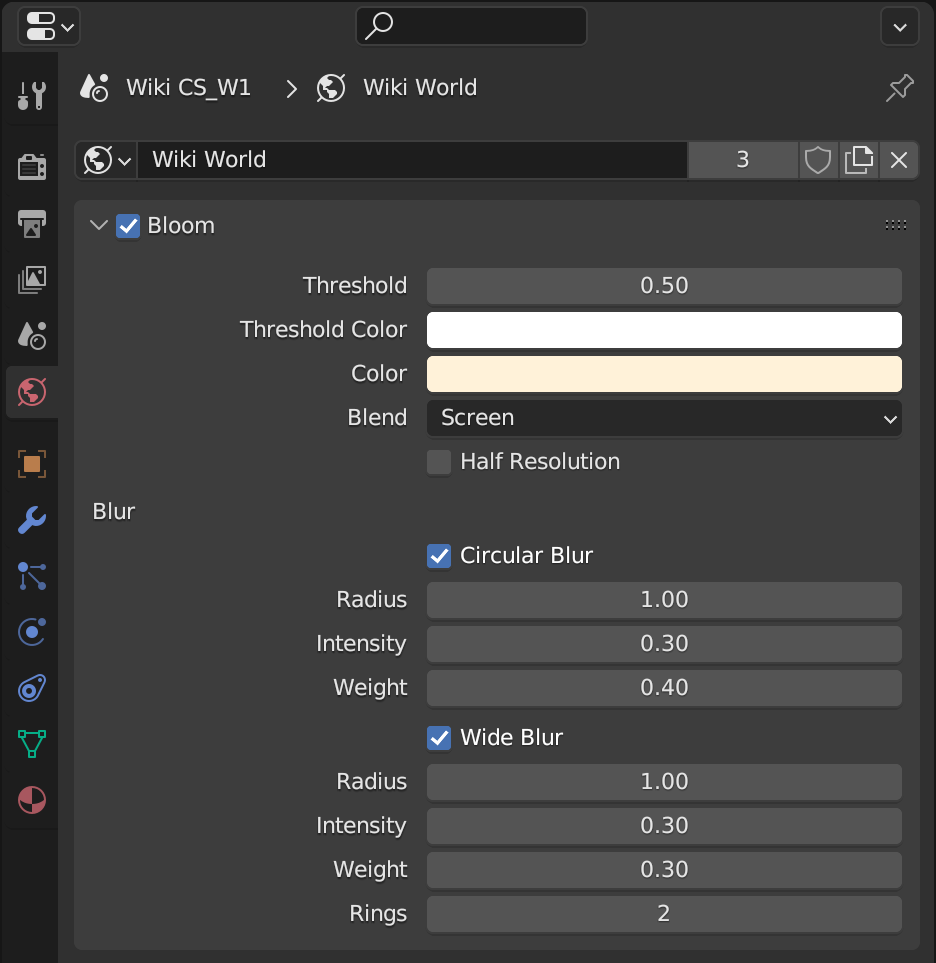

# Settings

### General

- **Threshold** (0 to 1) is the brightness above which the image starts to glow. The lower it is, the more of the image glows.
- **Threshold Color** tints the threshold for each color channel. A darker channel starts to glow earlier, so for instance a color with less green makes greens glow more.
- **Color** is the tint of the glow.
- **Blend** decides how the glow is put on the image:
  - **Add**: the glow is added to the image, which can turn bright parts fully white.
  - **Screen**: the glow brightens the image without clipping. Every Mario Kart Wii course uses this.
  - **Add (Alpha)**: the glow times the alpha of **Color** is added to the image.
  - **Alpha Blend**: the glow is mixed with the image by the alpha of **Color**.
  - **Multiply & Add**: the glow times the image is added to the image, which strengthens the colors that are already there.
- **Half Resolution** works at half the screen size instead of a quarter of it, for a finer glow.

### Blur

- **Circular Blur** blurs with samples on a circle, 8 at a time. When it's unchecked, a simpler blur of two samples side by side is used instead, and **Two Passes** runs that blur twice.
- **Radius** is the distance of the samples, in pixels of the small image.
- **Intensity** is the weight of each sample. Every sample gets added with this weight, so higher values brighten the glow quickly.
- **Weight** is the share of this blur in the glow.

### Wide Blur

The checkbox adds a second blur, made from the first one at half its size, which spreads the glow much farther. Its **Radius**, **Intensity** and **Weight** work the same as those of the first blur, and **Rings** decides whether it takes one ring of 8 samples or a second ring of 16 samples as well.

# Examples

These are all from the world 1 map with its `W1` lighting set, with a bloom added to it. The values of the example are:

- **Threshold** 0.5 with a white **Threshold Color**, a light warm **Color** and the **Screen** blend
- **Circular Blur** with a radius of 1, an intensity of 0.3 and a weight of 0.4
- **Wide Blur** with a radius of 1, an intensity of 0.3, a weight of 0.3 and 2 rings

Each of the other pictures changes just one thing.

| No bloom | Example values |
| -------- | -------------- |
|  |  |

The **Threshold** decides how much of the image glows:

| Threshold 0.35 | Threshold 0.62 |
| -------------- | -------------- |
| 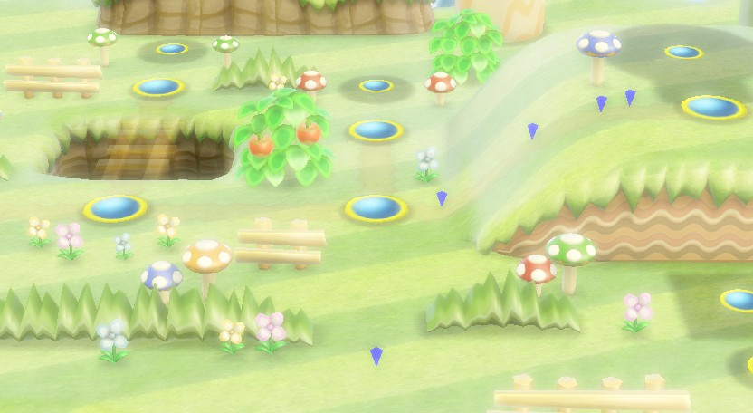 | 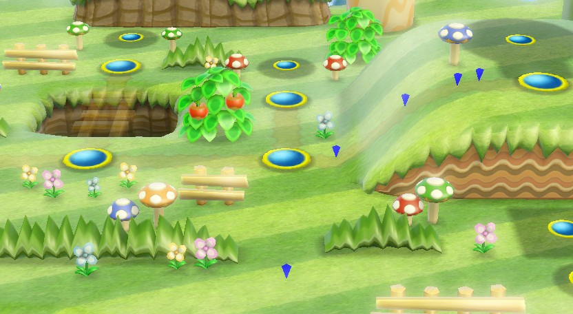 |

A **Threshold Color** with less green makes the green grass glow more than everything else:

| Threshold Color with less green |
| ------------------------------- |
| 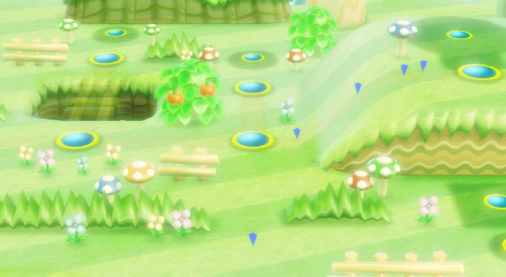 |

**Intensity** makes the glow brighter, and **Radius** makes it reach farther:

| Intensity 0.7 for both blurs | Radius 3, Wide Blur radius 4 |
| ---------------------------- | ---------------------------- |
| 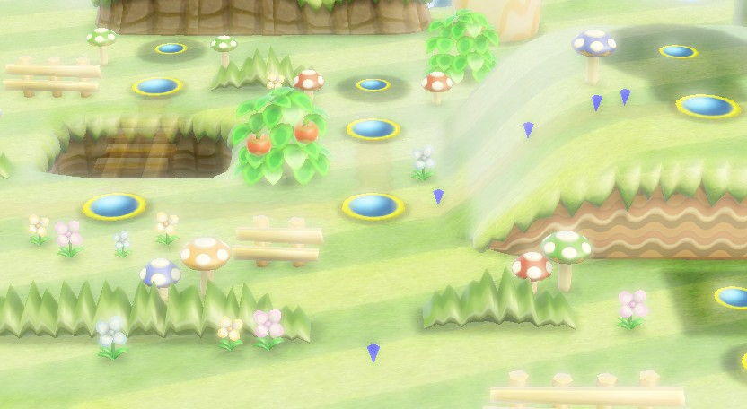 | 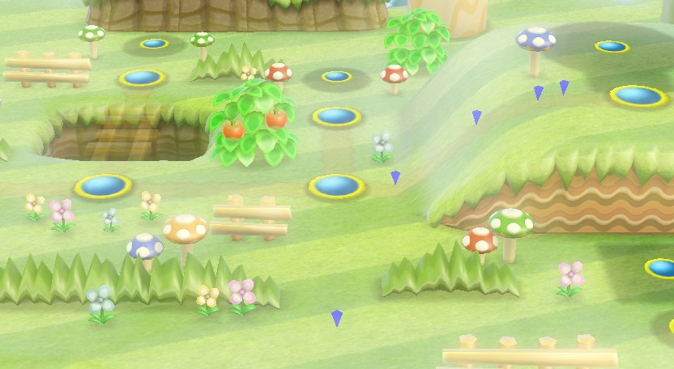 |

The wide blur gives most of the soft glow. Without it, or with its weight at 0, only a tight glow around the brightest parts is left:

| Weight 0.8, Wide Blur weight 0 | Wide Blur off |
| ------------------------------ | ------------- |
| 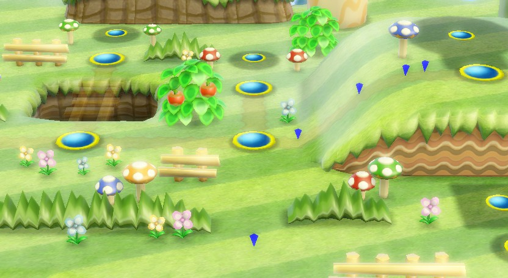 | 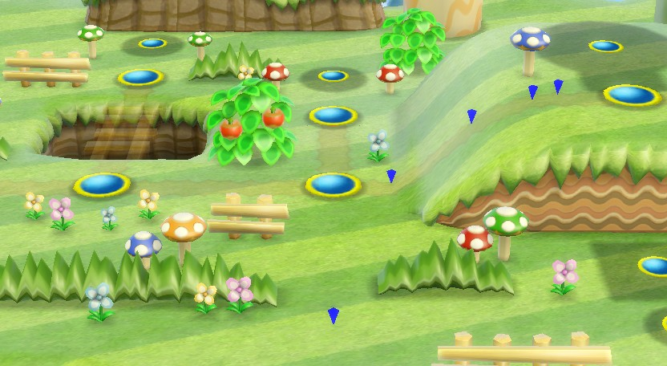 |

**Color** tints the glow, and the **Add** blend makes it much harsher than **Screen**:

| Light blue Color | Add blend |
| ---------------- | --------- |
| 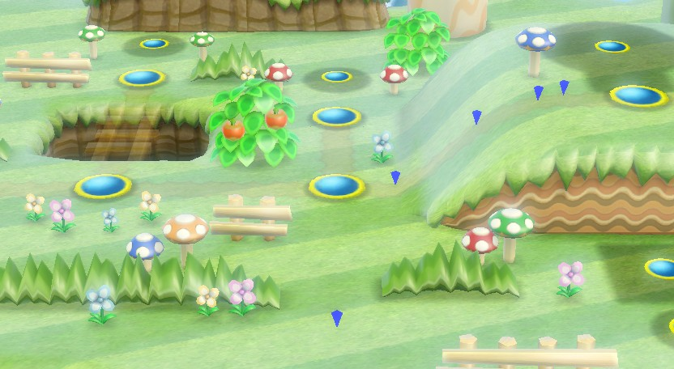 | 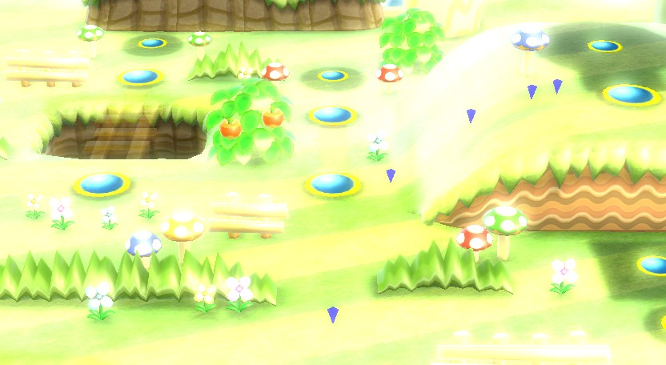 |
