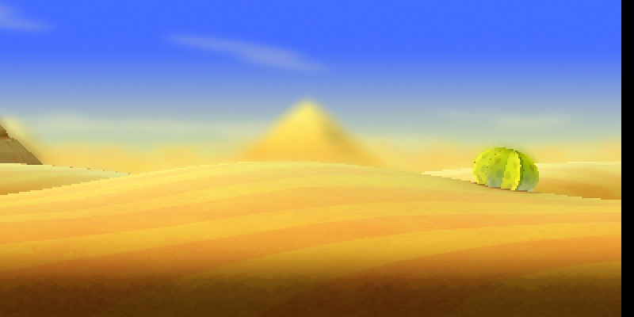
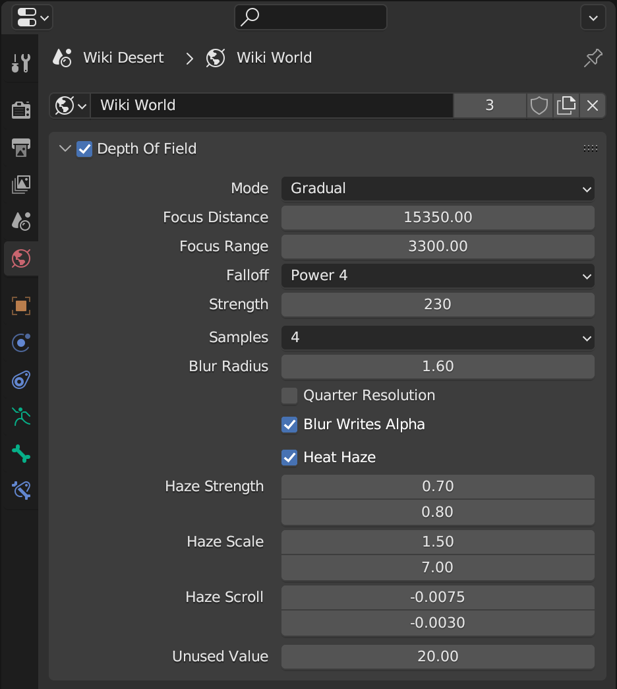
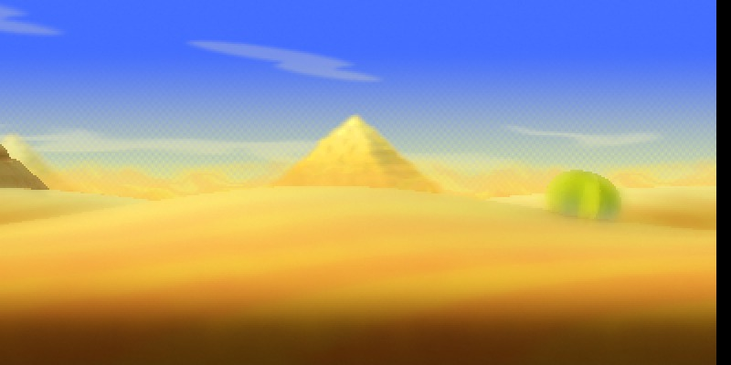
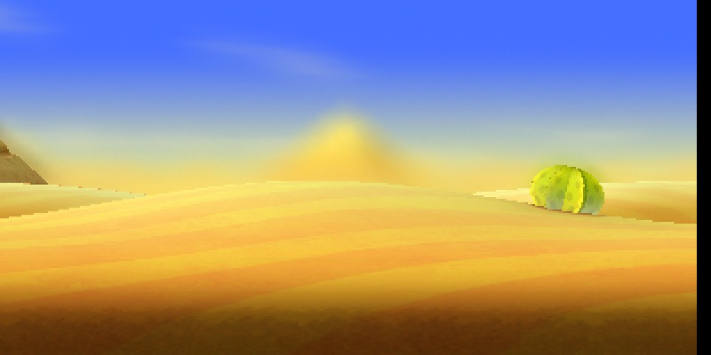
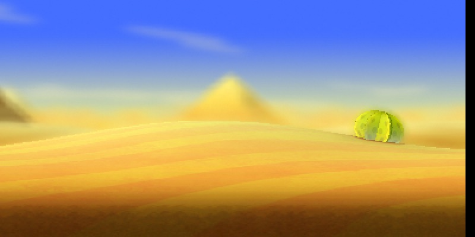

# Introduction

**Depth of field** blurs what's out of focus, depending on its distance from the camera. The base game only has three depth of field files, all in `Env_course.arc`: `SabakuDepth` (desert), `WaterDepth` and `KoopaDepth`. Levels pick one depending on the stage rather than by the name of the lighting set, which is why BerryBush lets you pick one separately when [[ loading a lighting set | Scene-Lighting#from-an-archive ]] and save it under its own name.

This is how the game draws it:

1. The image is copied at half its size (or a quarter of it).
2. That copy is blurred with a few samples around each pixel.
3. The blurred copy is laid over the image, more strongly the farther away a pixel is from the focus distance.

The game draws the depth of field right after the backgrounds, before anything else of the level. So in a level, it only ever blurs the backgrounds. BerryBush blurs everything in view by its distance instead, which matches the game as long as you're only looking at background models.

# The Depth Of Field Panel

The checkbox in the header decides whether the lighting set has a `.bdof` at all.

### Mode

- **Gradual**: the blur grows with the distance from the **Focus Distance**, which is read from the depth of the image.
- **Gradual (Fog)**: like Gradual, but the game works out the distance by drawing fog over the image. BerryBush shows it the same way as Gradual.
- **Split**: everything in front of the focus distance gets the **Near Strength** of blur, and everything behind it gets the **Far Strength**.

### Focus

- **Focus Distance** is the distance from the camera (in game units) that's in focus.
- **Focus Range** is the depth around the focus distance over which the blur grows to its full strength. Half of it lies in front of the focus distance, and the other half lies behind it.
- **Falloff** is how the blur grows across the focus range. **Linear** grows evenly, while **Squared** and **Power 4** stay low near the focus distance for longer.
- **Strength** is the opacity of the blur, from 0 (no blur) to 255 (full blur). In **Split** mode, this is split into **Near Strength** and **Far Strength**.

### Blur

- **Samples** is the number of samples taken around each pixel: 4, 2 or 1. With only one sample, the only blur left is the softness of the smaller image.
- **Blur Radius** is the distance of the samples from each pixel, in pixels of the smaller image.
- **Quarter Resolution** blurs a quarter size copy of the image instead of a half size one, which makes the blur wider and softer.
- **Blur Writes Alpha** lets the blur write to the alpha of the image as well. This has no visible effect in the preview.

### Heat Haze

**Heat Haze** distorts the blurred image with a scrolling texture (`dof/shimmer.bti` in `Env_course.arc`) for a hot air effect, which `SabakuDepth` uses in the desert. **Haze Strength** is how far it moves the image, **Haze Scale** is the tiling of the texture, and **Haze Scroll** is how far the texture moves each frame. BerryBush doesn't show the heat haze.

### Unused Value

The game reads and saves this number, but nothing in it ever uses it.

# Examples

This is the desert background of world 2 with `SabakuScene` and `SabakuDepth`, seen from the same camera as the [[ fog example | Fog#example ]]. The pictures show a part of the image at twice its size, so the blur is easier to see.

With `SabakuDepth`, the dunes and the cactus in front stay sharp, while the far pyramid (part of `bgB_0402`, which lies farther back) gets blurry:

| No depth of field | `SabakuDepth` as in the game |
| ----------------- | ---------------------------- |
|  |  |

Moving the **Focus Distance** back to 17300 puts the far pyramid in focus, and the cactus gets blurry instead:

| `SabakuDepth` | Focus Distance 17300 |
| ------------- | -------------------- |
|  |  |

A larger **Blur Radius** spreads the samples farther apart, which with only 4 samples turns into a doubled outline. **Quarter Resolution** gives a softer blur instead:

| Blur Radius 4 | Quarter Resolution |
| ------------- | ------------------ |
|  |  |

In **Split** mode with the focus distance at 15700, a **Near Strength** of 0 and a **Far Strength** of 255, everything behind the cactus is blurred at full strength, with no gradual change in between:

| Split |
| ----- |
|  |
