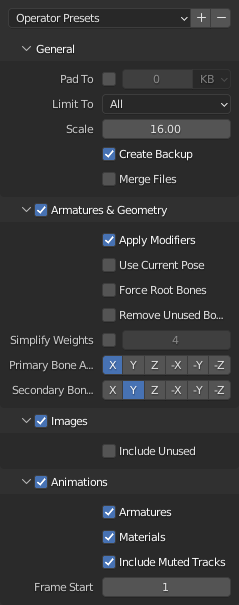

# General

### Pad To

This setting allows you to choose a "goal size" to which the exported file will be padded with null bytes. This is useful for testing mods via Riivolution in Dolphin, which lets you replace files without restarting your game as long as their sizes don't change.

### Limit To

Optionally, export can be limited to only selected objects or only visible objects. If either of these modes are used and an object passes the test (it's selected/visible), the entire armature used for parenting or rigging the object will be also exported (doesn't have to be selected/visible). **In any case, only objects with armature/bone parenting or armature deformation are exported.** The verifier setting with the same name applies its limiting using the same method as described here.

### Scale

Export is scaled up by this factor. Recommended values are 16 for most models and 30 for worldmaps, as these values result in 1 "tile" being equivalent to 1 Blender unit.

### Create Backup

If enabled and a file with the with the same name as that being exported already exists, a backup of that file will be created.

### Merge Files

If enabled and a file with the with the same name as that being exported already exists, the exported file will be merged into that one. During merging, the existing BRRES is used as a base, and all of the sub-files (models, textures, animations, etc.) from the newly exported BRRES are added to it. If any sub-files in the new BRRES have the same names as sub-files from the old one, the old ones will be overwritten.

This is useful for taking advantage of existing BRRES files without having to deal with the bloat that BerryBush normally adds during import & export. For instance, if you wanted to export a new model for Larry without replacing his animations, you could disable animation export and then merge with his original file. This saves a bunch of space that BerryBush would normally waste with its standard animation export, and it makes your workspace a little simpler since you don't have to worry about having all the animations there. (For the 200+ player animations, a workflow like this is a necessity, as you can now pick & choose which ones to export while leaving the rest alone)

Note that any sub-files in the base BRRES with the same names as those being exported will be overwritten. Additionally, stuff from the base file will generally be left untouched, but if it uses BRRES features unsupported by BerryBush, it may still be modified. Be sure to make backups when using this feature!

# Armatures & Geometry

### Apply Modifiers

If enabled, mesh modifiers such as Subdivision Surface will be applied on the exported model.

### Use Current Pose

If enabled, the current armature pose at the time of exporting will be used as the BRRES rest pose.

### Force Root Bones

Certain armature setups are allowed in Blender but not in BRRES. So, in some cases, an extra bone may be added at the root of an exported armature to compensate for this. These cases are as follows:
- The armature has multiple bones at the root level (all root bones will become children of the new bone)
- There are objects that are direct children of an exported armature rather than a particular bone (these objects will become children of the new bone)
- There are meshes with incomplete weight painting for armature deformation (vertices with unset weights will become weighted to the new bone)
- There are meshes without drivers for [[ bone visibility links | Animations#vis]] (these objects are assigned to the new bone for visibility)

When a new root is added, it's named after the armature (**not** the object containing it; that's used for the name of its corresponding [[ MDL | Import-Options#merge-duplicate-materials ]]).

This behavior should generally not have any negative effects, and it exists to make exported models behave in ways that you would expect. However, if you would like the current root of your armature to be kept at the root and used in place of this extra bone, you can enable this option. This can be convenient in cases where the game expects the root bone to have a certain name or certain other properties, and it's easiest to just manipulate those directly. If an armature has multiple root bones and this is used, one will arbitrarily be chosen as the new root and the others will be made its children (so avoid doing that, as only one root is supported in BRRES).

### Remove Unused Bones

If enabled, only bones used for deforming and visibility (and their ancestors) are exported. Other bones are still taken into account for constraint & driver evaluation, but are not included in the final BRRES armature(s), which can improve performance.

### Simplify Weights

This setting limits vertex weights based on a fixed number of steps between 0 and 1, which can improve both file size and performance at the cost of potentially creating artifacts in deformed meshes. Enabling this is **highly recommended** for models that weren't already imported from BRRES files. Adding more steps can help with quality loss, but lessens the gains that come with this feature.

### Bone Axes

The Primary & Secondary Bone Axes decide how your model's bones should be re-oriented on export. Blender's primary and secondary bone axes are fixed to Y and X respectively, but BRRES models tend to follow different conventions, so there's an [[ import setting | Import-Options#bone-axes ]] to help with this. This export setting exists to ensure that you can always use the same conventions when importing and exporting, which can have effects in cases where bones are used to transform other models (such as the "jnt_wing" bone in the Goomba model which determines how the Paragoomba's wings are placed). If unsure, leave at the defaults.

# Images

### Include Unused

By default, images are not included in BRRES exports if they're not used by the exported model. If this setting is enabled, all images in the current Blend file are included.

# Animations

### Include Muted Tracks

If this setting is enabled, all NLA tracks are used for export as long as they meet the conditions described [[ here | Animations ]]. Disable this setting to ignore tracks that are muted.

### Frame Start

This subtracts an offset in frames from all animation so that it can be exported according to your chosen starting frame.