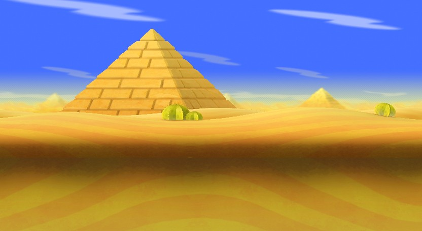
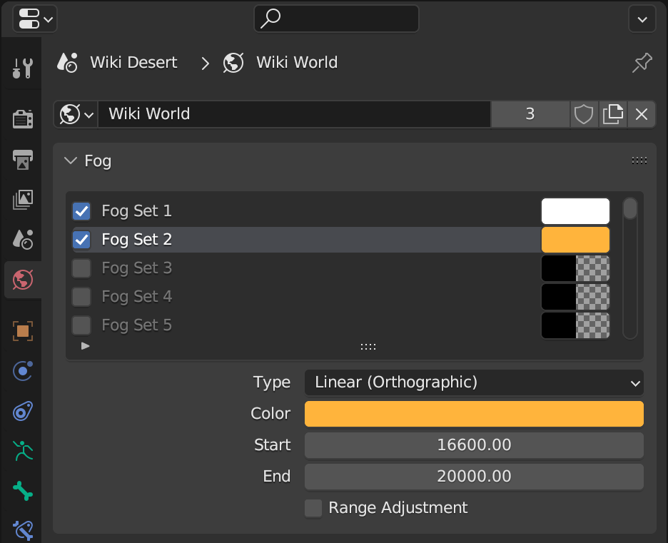
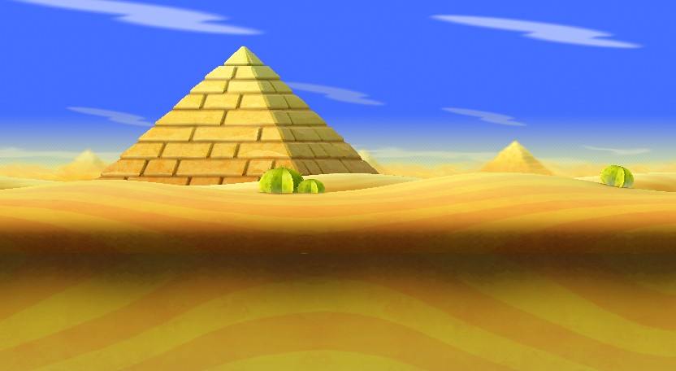
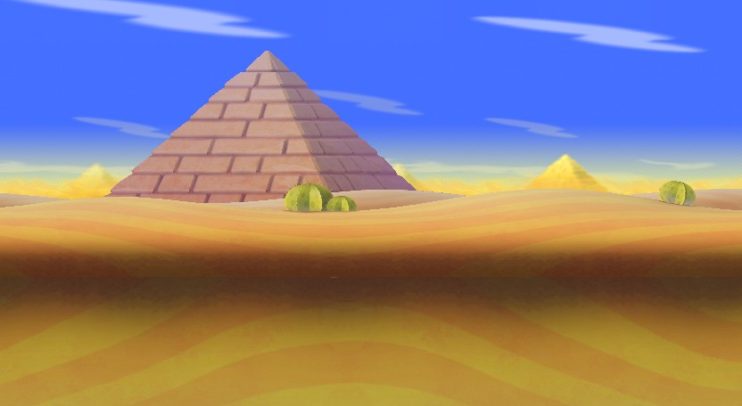
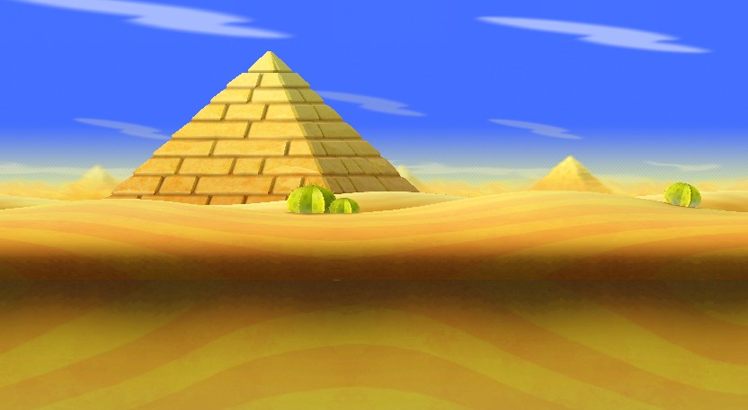

# Introduction

**Fog** blends the color of a surface toward a fog color, the farther away from the camera it is. The `.bfog` file of a lighting set holds 32 **fog sets**. Just like light sets, materials pick one by its number: the **Fog Set** setting in **Material Properties > BRRES Settings > Misc.** picks the fog set with the same number in the list (see the screenshot in [[ Light Sets | Light-Sets#using-a-light-set-in-a-material ]]). If its checkbox is unchecked, the material has no fog.

In the base game, the level lighting sets of `Env_course.arc` use fog sets 1 and 2, and most background models pick fog set 2. The world maps don't load a fog file at all, even though most of their materials pick fog set 2. (The only fog file of `Env_world.arc`, `Layout3D.bfog`, uses fog sets 3 and 4.)

# The Fog Panel

The list shows the fog sets, each with a checkbox that turns it on and off and a swatch of its color. For the selected fog set:

- **Type** is the curve of the fog. **Linear** fog grows evenly from no fog at the start to full fog at the end. **Exponential** fog grows quickly right after the start and slowly toward the end, **Reverse Exponential** fog does the opposite, and the **Squared** versions make these curves even stronger. **None** turns the fog off.
- **Color** is the color that the fog blends toward.
- **Start** and **End** are the distances from the camera (in game units) where the fog starts and where it's complete. If they're the same, there's no fog at all.
- **Range Adjustment** corrects the fog toward the edges of the screen, where surfaces are farther from the camera than their depth suggests. BerryBush doesn't show this correction.

Each type comes in a **Perspective** and an **Orthographic** version. Ingame, the version has to match the kind of camera that the model is drawn with, or the fog ends up at the wrong distances. The level lighting sets of the base game use **Linear (Orthographic)**. BerryBush works out the distance directly, so it shows both versions the same way.

The file also stores near and far planes, which the game always replaces with those of the camera. BerryBush keeps them as they are without showing them.

# Example

This is the desert background of world 2 (`Object/bgA_0402.arc` and `Object/bgB_0402.arc`) with `SabakuScene`, the lighting set it's used with in levels. The materials of `bgA_0402` (the dunes, cacti and the big pyramid) use fog set 2, which starts at 16600 and ends at 20000 in this set. `bgB_0402` (the sky and the far pyramids) uses no fog.

The camera of these examples is placed so that the background is about 15500 to 17500 game units away, which is closer than where the fog of `SabakuScene` starts, so it has no visible effect there (first picture). Moving **Start** to 15400 and **End** to 16400 makes the farther parts of `bgA_0402` fade into the orange fog:

| As in the game | Start 15400, End 16400 |
| -------------- | ---------------------- |
|  |  |

| Start 15400, End 16400, purple color | Start 15400, End 20000 |
| ------------------------------------ | ---------------------- |
|  |  |

With the end much farther away, the same distances only get a light haze, as the fog takes much longer to grow.
