# Introduction

In this guide, you'll learn the fundamentals of importing & exporting BRRES models for use in NSMBW using BerryBush by following along with a few examples. For simplicity, we'll be working with the base game (i.e., not Newer), but the content of this guide should be pretty universal. You can always refer to [[ the rest of the wiki | Home ]] for further details on anything discussed here. If you haven't installed & enabled BerryBush yet, you can learn how to do that [[here|Installation]].

## Table of Contents
- [[ Example 1: Desert Background (import, export, lightmaps, & material basics) | Getting-Started#example-1-desert-background ]]
  - [[ Importing Into Blender | Getting-Started#importing-into-blender ]]
  - [[ Importing Lightmaps | Getting-Started#importing-lightmaps ]]
  - [[ First Edit and Export | Getting-Started#first-edit-and-export ]]
  - [[ Materials | Getting-Started#materials ]]
- [[ Example 2: POW Block (models from scratch, animations, & all about materials) | Getting-Started#example-2-pow-block ]]
  - [[ Initial Material Setup | Getting-Started#initial-material-setup ]]
  - [[ Preparing For Export | Getting-Started#preparing-for-export ]]
  - [[ Animations | Getting-Started#animations ]]
  - [[ Lighting | Getting-Started#lighting ]]
  - [[ Even More Material Stuff | Getting-Started#even-more-material-stuff ]]

# Example 1: Desert Background

## Importing Into Blender

We'll start with a basic background edit to get used to importing & exporting BRRES files. We'll be working with the front portion of NSMBW's main desert background (`Object/bgA_0402.arc`). First, extract the BRRES from the archive via any U8 archive manipulation tool. You can do this with BrawlBox by opening the archive, clicking on the BRRES, and then using **Right-click > Export** or **Ctrl+E**.

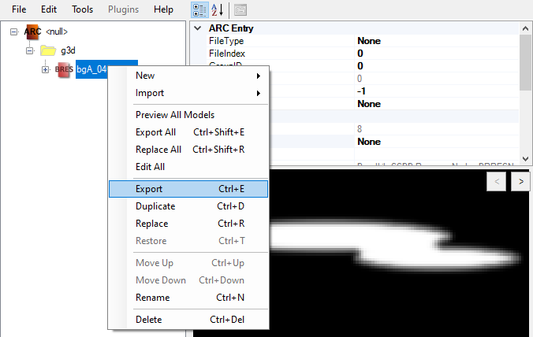

Now, you can switch to Blender. Make a new Blend file and save it so you won't lose your progress. You can name it whatever you want. Delete everything in the scene for a fresh starting point.

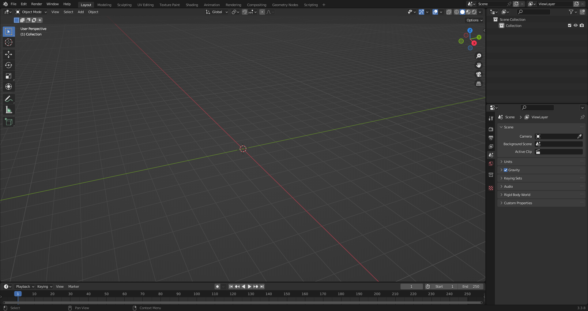

Then, use **File > Import > Binary Revolution Resource (.brres)** to import the model into your scene. You can keep all of the import settings at their defaults for now. Once you've done this, you should see something like this in your viewport:

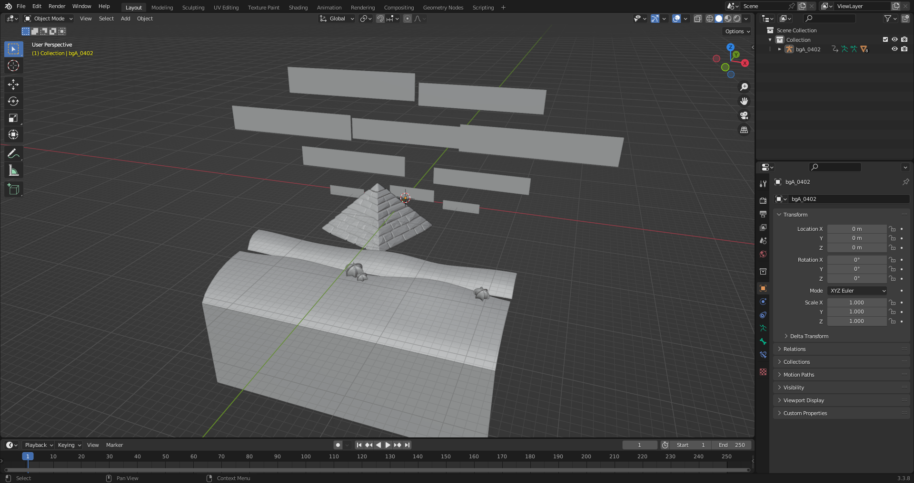

Congrats, you just imported your first BRRES! Now, you'll configure the scene to preview what the model will look like ingame. In order to do this, set your scene's render engine to **BerryBush**. To ensure that colors are displayed accurately, it’s also recommended that you set the View Transform to **Standard**. All other settings can be left at their defaults. Finally, you can switch the viewport shading mode to **Material Preview** or **Rendered** (which currently function identically in BerryBush) to check out the model in its full glory.

Sidenote: After the model has been imported, **don't rename anything** from it. The game's code sometimes references things in models by name, and names that are used like this can't be changed without code edits. Most name changes should be fine, but for now, just play it safe.

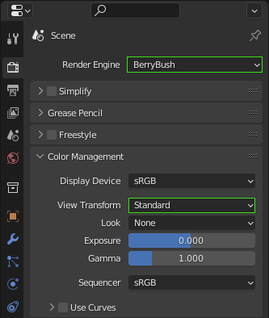

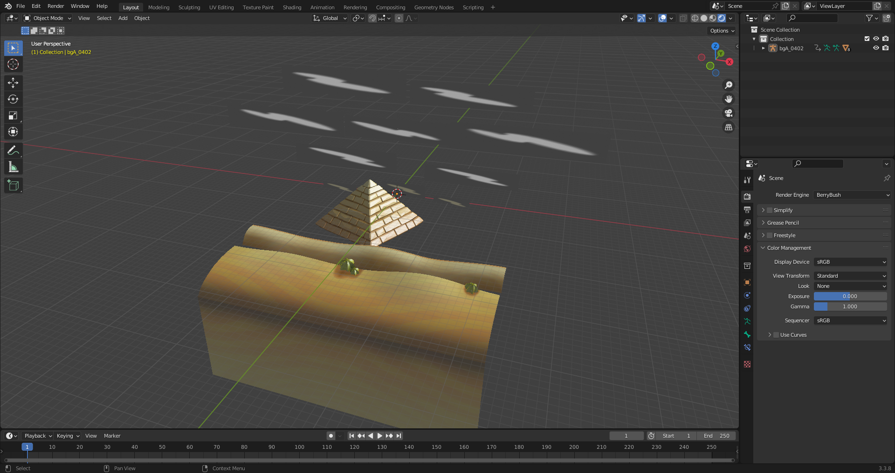

Looking good! For a background like this, it might also be useful to use the Front Orthographic view (**Numpad 1** by default) for a better idea of how things will look ingame.

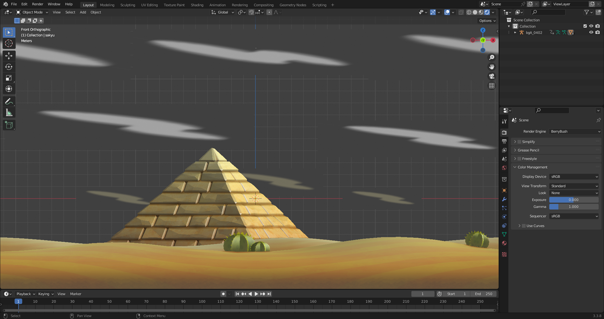

One thing you've probably noticed is that even though we set the View Transform for more accurate colors, our model still looks a bit off. Compared to what you see in NSMBW, everything seems a bit gray and washed out. That's all thanks to lightmaps.

## Importing Lightmaps

A **lightmap** is an image that stores pre-calculated lighting information to make something appear as though it's affected by light, and lightmaps are one of a few techniques used to pull off lighting in this game. Currently, the lightmaps in our model are a bit strange, which is why we're getting these odd colors. Open Blender's Image Editor to examine the model's images.

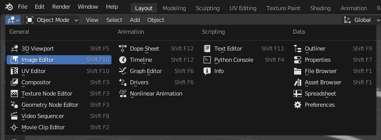

The lightmap images are the ones prefixed by `lm`. Select one of these to take a look at it.

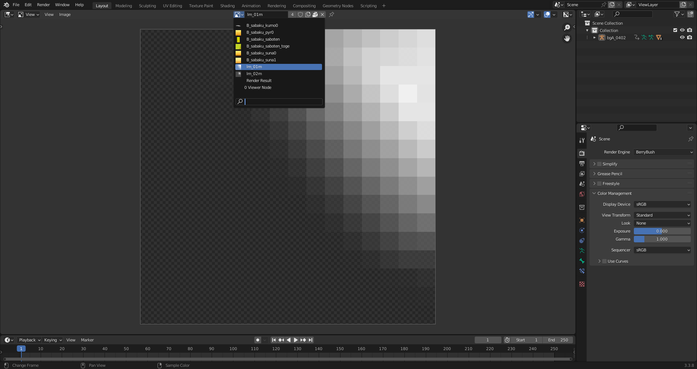

This is not typically what these images are supposed to look like. So, how does the game fix this?

In short, NSMBW relies on lightmaps that are generated **while it's running**. The lightmaps we see in this model are never actually used; they're just **placeholders** that get swapped out for the real ones after they're created. That means that while things look good ingame, we're stuck with these dummy images in Blender. And in most cases, these don't look too great - one that shows up in some other files even has "obj" written on it!

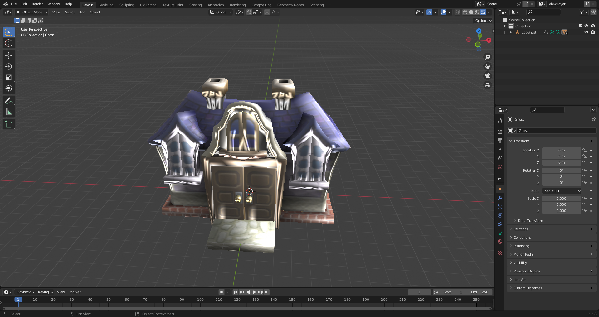

Yikes. The easiest fix is to let BerryBush generate the real lightmaps, just like the game does. For that, you load the game's lighting files for this background, which is the `SabakuScene` lighting set of `Env/Env_course.arc`. The [[ Scene Lighting | Scene-Lighting ]] guide shows how.

There's also a fix that works without the lighting files, and it's worth knowing too. Because these images are unused, you can replace them with placeholders of your own without affecting how things will look ingame. So, we'll use Dolphin to **extract some proper lightmaps and use them instead**. If you're not interested in this part and would like to just keep the existing images, you can skip to the [[ next step | Getting-Started#first-edit-and-export ]].

Start NSMBW in Dolphin and enter a level that uses our desert background, such as World 2-1. Then, open the Graphics settings. Navigate to **Advanced > Dump EFB Target**, and enable the checkbox. This will create a lot of image files, so don't leave it on for too long. You should be able to disable it after a few seconds.

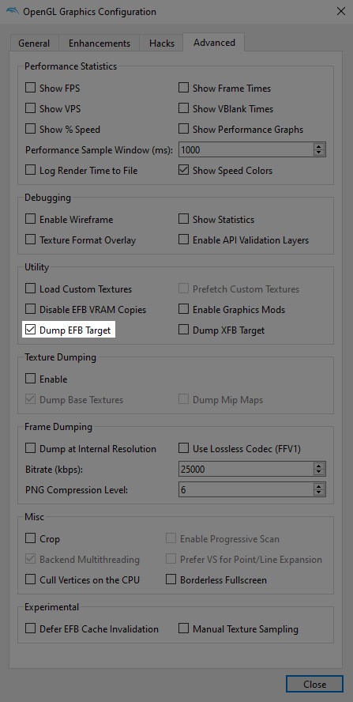

Along with some other images, this will dump the desert course lightmaps, which are the ones we want as they're the ones that will be applied to our model. You're encouraged to **repeat this process** in the future whenever you want a new set of lightmaps for a new environment.

To see the dump, click **File > Open User Folder** in Dolphin, and then navigate to **Dump/Textures**. The lightmaps should've been dumped here, plus a few other things. The first 20 images dumped (the spheres with shading) are the only ones that we care about. Everything else can be deleted.

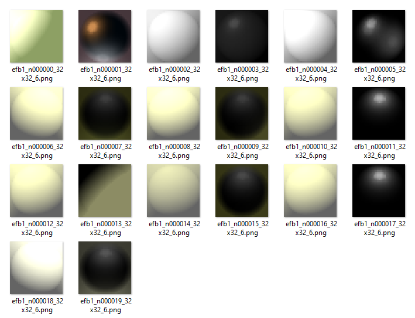

Now that we've dumped the lightmaps, it's time to load them into Blender. Recall that our model had two lightmap images: `lm_01m` and `lm_02m`. These names are important, as they're how NSMBW decides which images should be replaced with generated lightmaps. You can throw in whatever image you want, name it `lm_01m`, and it will always be replaced by the `lm_01m` lightmap image during runtime. Each of the 20 images we dumped corresponds to a unique name. So, we have to figure out which of those images are `lm_01m` and `lm_02m`. Fortunately, there's a guide from the [[ Horizon Wiki | https://horizon.miraheze.org/wiki/File:Lightmap_Documentation.png ]] that makes this really easy:

The images are always dumped in the same order, so this diagram pairs each image in this order with its name. If we needed, say, `lm_04b`, it would be the 18th image in the dump. We're looking for `lm_01m` and `lm_02m` here, so we just need the **first two images**. Rename these to `lm_01m.png` & `lm_02m.png` and move them to the same location as your Blend file. Feel free to delete the entire contents of the Dump folder now.

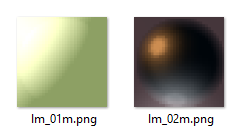

Images in imported BRRES files are packed by default, which means that their data is stored within your Blend file rather than in an external location. To use your external images, you'll have to unpack the ones in the model. On each lightmap image in Blender, click the **Unpack Item** icon, then choose **Use file in original location (create when necessary)**. Ensure that you do this for both images. This will replace the images in Blender with ones in your model's directory. If you didn't rename & move your dumped images, it'll create new images in this location, which you can just replace with the dumped ones.

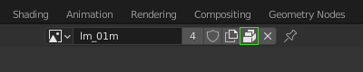

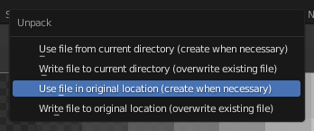

Note that these are just regular Blender images. If you want to change their external paths after unpacking, you can do so as you would normally. Just know that although the filenames can be whatever you choose, the image names in Blender (which are allowed to differ from filenames) must be the lightmap names (without extensions such as `.png`).

Once you've unpacked your lightmap, reload your Blend file or click **Image > Reload** on each image so that they'll be updated in Blender.

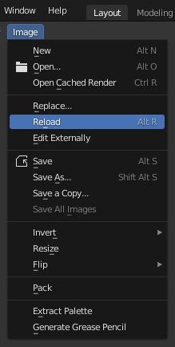

Going back to the 3D viewport, things have improved a lot. Our lightmaps aren't actually perfect yet, but we'll fix that later in this example, as it involves a feature within the BRRES material settings. We'll stick with this for now, as it's still a huge step up from what we had before.

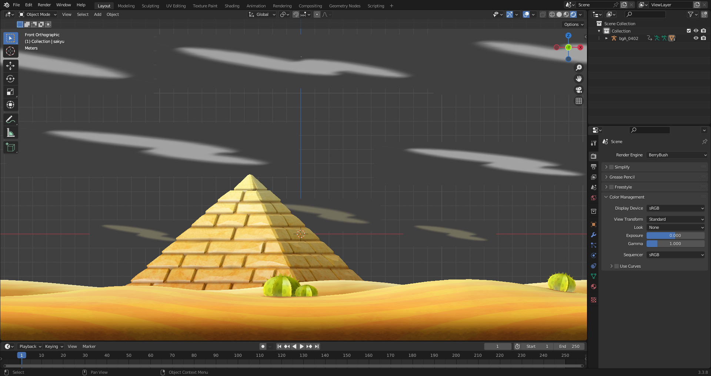

## First Edit and Export

Our first change will be a simple edit to the pyramid in this background, which we'll flip upside-down like the pyramid from Super Mario Odyssey. We'll do this via a 180° rotation on the Y axis, along with a location offset of -9 on the Z axis to keep it grounded:

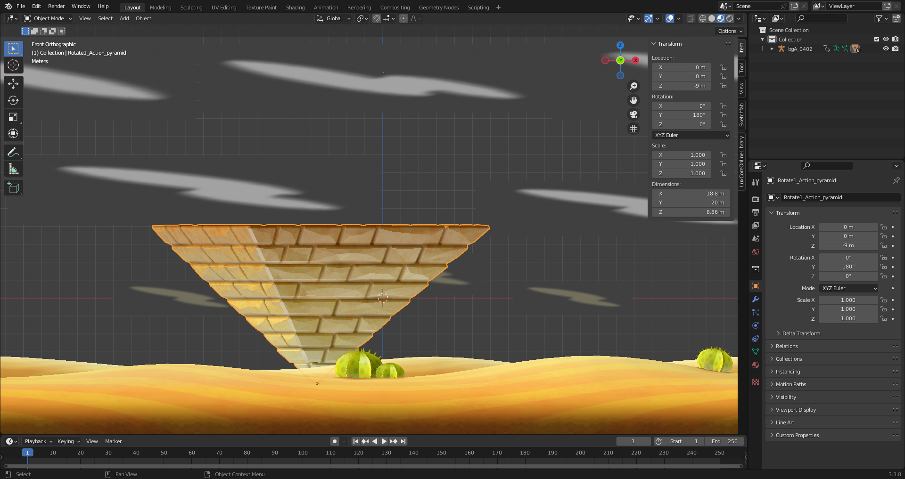

You can apply these transforms with **Ctrl+A** if you'd like, but that's not necessary for BRRES export.

Now, we'll export the model with our changes. First, we'll use BerryBush's verifier to ensure that our BRRES data is all valid. To open the verifier, press F3 anywhere in Blender and search for **Verify BRRES Settings**. If nothing comes up, enable **Developer Extras** under the Blender preferences:

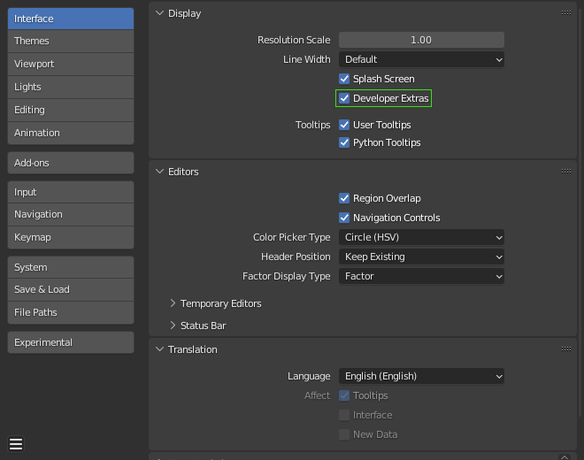

With that enabled, this is what the search results should look like:

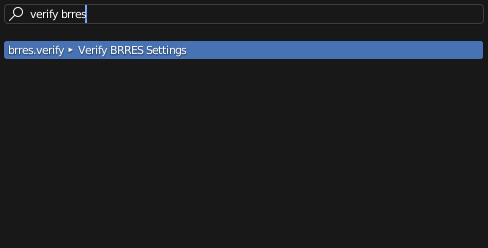

Select the option or press Enter and the verifier options will appear. You can go with the defaults for now, so just click OK, and a message will show up at the bottom of the screen with the verification results. We didn't make many changes, so we should expect that our model will pass every test:

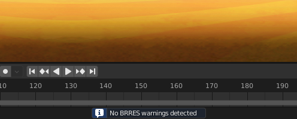

...but if you followed the lightmap extraction process, your screen might actually look more like this:

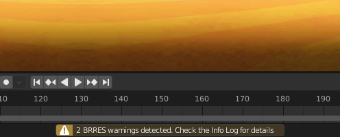

In that case, you should check out the problems that BerryBush found by clicking on the warning text to open Blender's **Info Log**. Here, you'll find that the verifier has given you warnings about the lightmaps' dimensions:

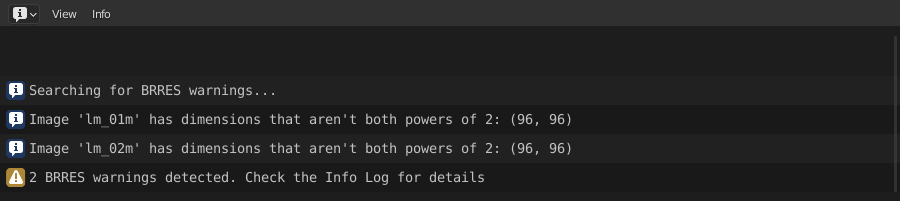

This is because when working on BRRES models, it is strongly recommended to ensure that your images' heights and widths are always powers of two. Images that violate this rule may seem fine in Dolphin, but will not render properly on console when used with certain wrapping modes. Therefore, it's best to just **stick to powers of two whenever possible**. The lightmaps we brought in are both 96x96, so they'll trigger these warnings whenever you use the verifier on your model. We'll learn how to suppress these warnings on a per-image basis later. For now, you can just ignore them.

Since everything other than that looked good, let's export our model with **File > Export > Binary Revolution Resource (.brres)**. You can keep all of the export settings at their defaults for now. During export, the verifier is run automatically for your convenience, which means that using it manually (as we just did) shouldn't actually be needed very often. Once export is finished, put your new BRRES into `bga_0402.arc` in place of the old one. You can do this with BrawlBox by opening the archive, clicking on the BRRES, and then using **Right-click > Replace** or **Ctrl+R**.

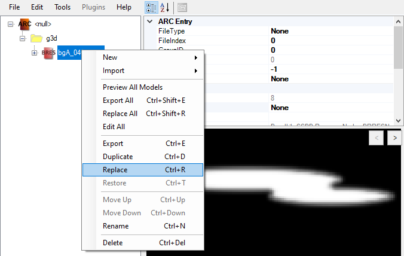

If you replace the BRRES using BrawlBox, its original name (`bgA_0402.brres`) is preserved, meaning that the name of the file you exported via BerryBush doesn't matter. However, if using another method, ensure that the BRRES in the archive **still has the same name** after replacement. If its name is changed, the game won't be able to locate the model.

**Warning**: You might notice that there's a pretty significant difference in **file size** between the original model and our new one, even though we hardly changed anything. This is an unfortunate limitation of BerryBush for now. The goal so far has been to release this tool as soon as it might be useful to somebody (with reasonable stability), so file size optimization hasn't been a huge priority yet. NSMBW luckily doesn't use a whole lot of RAM on its own, but the space available in the Wii's memory is still limited, so using several large BerryBush-exported models at once can lead to crashes. Fixing this will be a priority from here on out. Apologies for any inconveniences it causes in the meantime.

Anyway, now that we've exported our edited model, let's check it out ingame. Load up NSMBW on either Dolphin or an actual console, using Riivolution to replace the original background with the new one. If everything went right, you should be able to enter a desert level and see this:

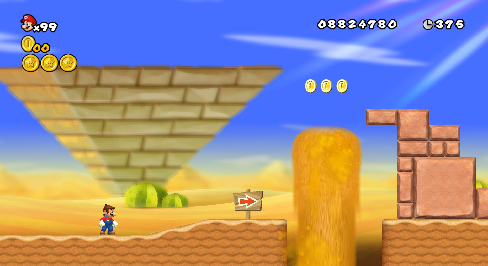

Congrats, you just exported your first BRRES! Now that we've been through the whole process, we'll make some more changes to the model.

## Materials

Have you noticed how the pyramid's color fades from darker at its base to lighter at its point? It's subtle, but now that we flipped it upside-down, this gradient looks a little odd. We're going to change that by editing the pyramid's material. First, we'll try to figure out where this coloring is coming from. Select the pyramid and then open **Material Properties** to view its BRRES material settings.

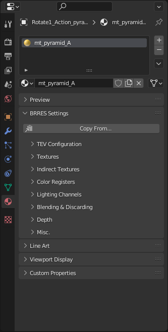

The first thing we'll be looking at is the TEV configuration. Expand the **TEV Configuration** panel to view it.

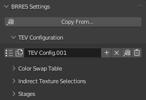

TEV configs (called “shaders” in BrawlBox) determine **how pixel colors are evaluated** by a piece of Wii hardware called the **TEV** (Texture Environment), **based on inputs from the other material properties**, such as textures. TEV configs can be reused between different materials, which is the case in this model; the same TEV config is actually used for the pyramid, sand, and cacti (except for their thorns). TEV configs have their own unique names in BerryBush, though these names are not stored in BRRES files, which is why the name of the pyramid's config is just auto-generated (`TEV Config.001`). Because of this, you can always change these names as you please. You can have unlimited TEV configs in your scene, and you can add, remove, or duplicate them as you like.

The meat of any TEV configuration lies in its **stages**. Expand the **Stages** panel to view these.

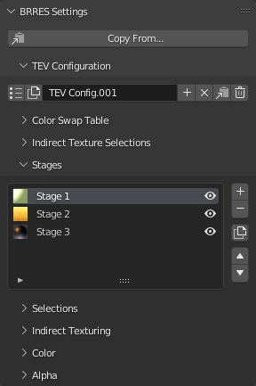

Each stage defines one color & alpha calculation, and the stages are run sequentially for each pixel on an object being rendered. A stage takes inputs from a variety of sources (including textures, vertex colors, and more), and then performs computations using those inputs to get some output color, which can then be used as an input for another stage (or the final output).

For now, we won't go into too much detail on how exactly these computations operate. However, you can get a rough high-level idea of what each stage does by clicking on the **Hide Stage** icons at the right of the stage list. We're trying to figure out where exactly the pyramid's gradient coloring is coming from, so let's hide every stage except the first one and see if it sticks around.

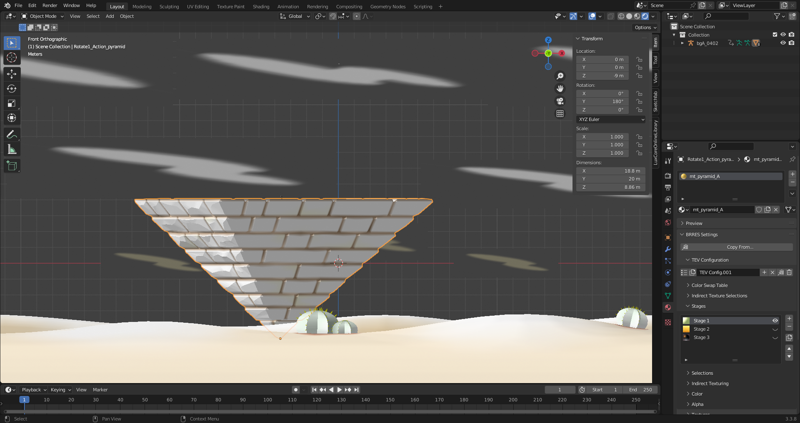

Notice how this affected more than just the pyramid we have selected. As previously mentioned, this TEV configuration is also used by the sand & cacti (except for their thorns, which use a unique material & TEV config), so **changes to it will affect them as well**.

Anyway, it looks like the gradient's gone now, so let's enable Stage 2 and see if it comes back.

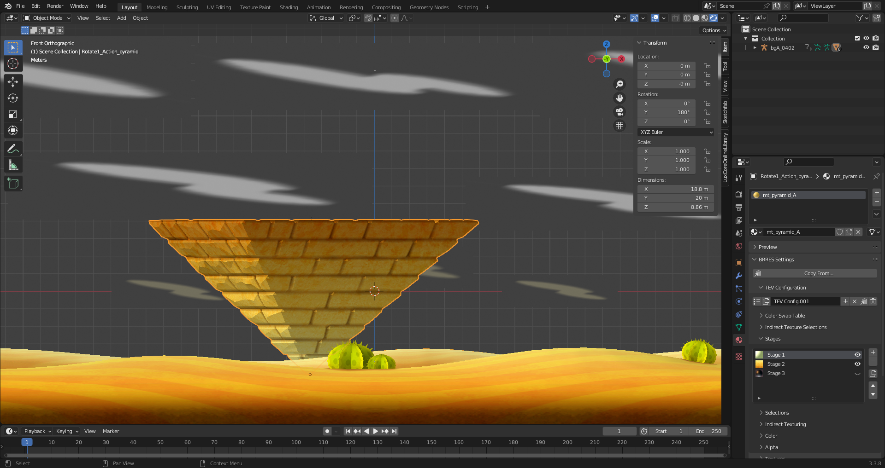

There it is! So, it seems like Stage 2 is responsible for the gradient. Let's mute Stage 1 to get a better look:

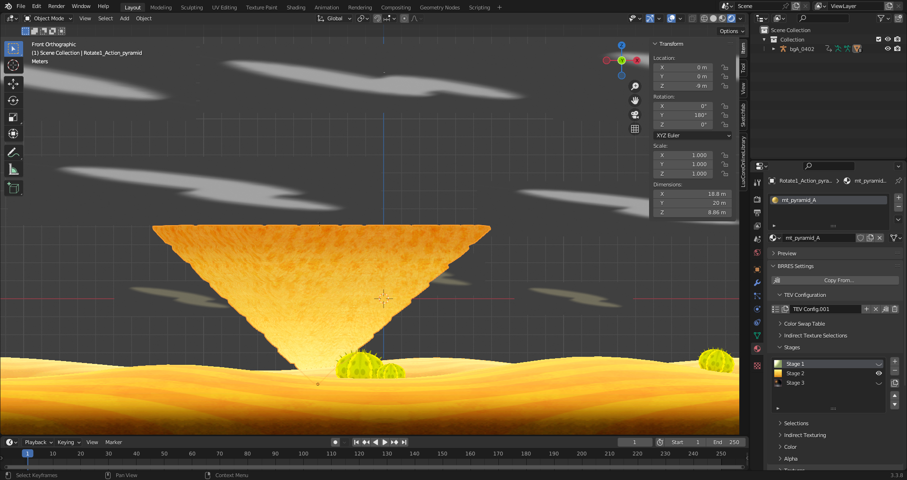

At this point, we know that whatever's creating that gradient will be in Stage 2's settings. We'll keep things simple for this first example and won't go into too much detail, but peering into the **Color** panel reveals that from a glance, the gradient seems to be in a texture.

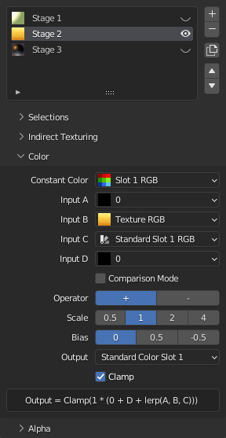

Let's check out this texture. Close the **TEV Configuration** panel, and then open the one that says **Textures**. This will reveal three textures used by this pyramid's material, all three of which we've seen before in some capacity.

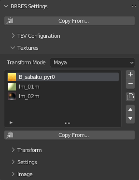

The first one is the texture with the gradient which we just discovered. The other seem to be the lightmaps we imported. Let's look through the first texture for a minute. Open the **Image** panel. Keep it on the **Active Image** tab; we won't be using **Animation Slots** for this tutorial.

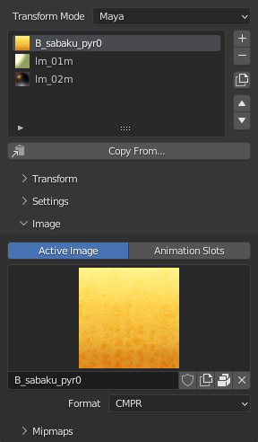

This is where you can set this texture's image. It's worth noting that in BerryBush, **images** and **textures** are distinct concepts. While a "texture" is an entry in the Textures list (unique for each material), an "image" is a file loaded into Blender like the lightmaps we loaded earlier. Images are used by textures, and an image can be used by one or multiple textures. The second and third entries in the list we're looking at right now are **textures** that contain our lightmap **images**. The texture we're looking at right now is called `B_sabaku_pyr0`, and it uses an image with the same name (though this shared name is not required).

To get used to this, try changing this texture's image. Here's what the pyramid looks like with its main texture's image swapped out for that of the cacti (and without TEV stages 1 and 3 applied, since we still haven't unhid those):

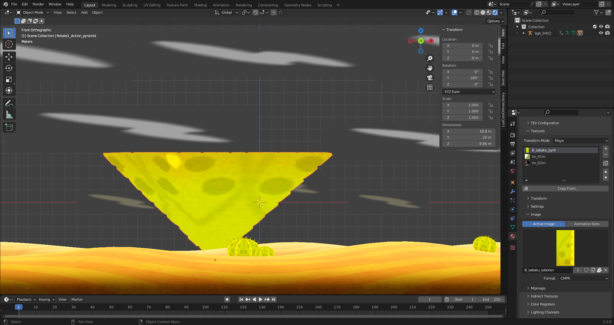

Each image has a **format**, which can also be set in this panel. Formats decide how images are stored, and each one strikes a different balance between compression and visual quality. The format chosen for an image is reflected in the BerryBush render engine. It is not reflected in the image preview, which shows the image's original form. Try testing this out by changing the format of `B_sabaku_pyr0` to **I8**, which only supports grayscale images:

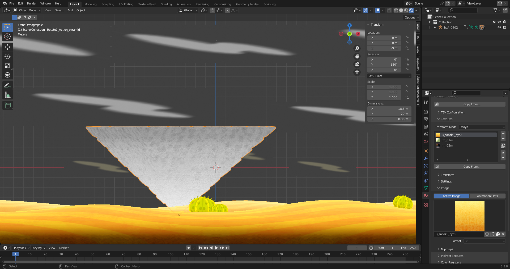

As you can see, the texture has been converted to black-and-white in the viewport, but it's kept colored in its preview. You can switch it back to **CMPR** now, or just leave it if you like the white pyramid aesthetic.

Close the Image panel for now. Our goal here was to flip the gradient, which we could accomplish this by flipping the image upside-down in the Image Editor, but there's also another way. Before we get to that, we'll take a brief detour to the **Settings** panel.

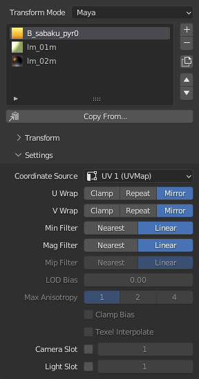

Here, you can configure a bunch of standard texture properties. We won't get to most of these in this example, but you can feel free to mess with them for a moment. Some are disabled because they're only relevant when **mipmapping** is used, but that's something else which we won't get to here. Once you're done experimenting with this panel, close it up and then open **Transform**, which is the one we've been waiting for.

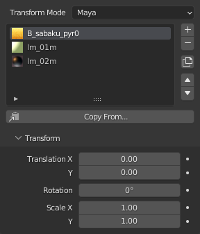

In this panel, you can move textures around visually via translation, rotation, and scaling. BRRES also supports animation for all of this. To flip our texture around, we'll just use a 180° rotation:

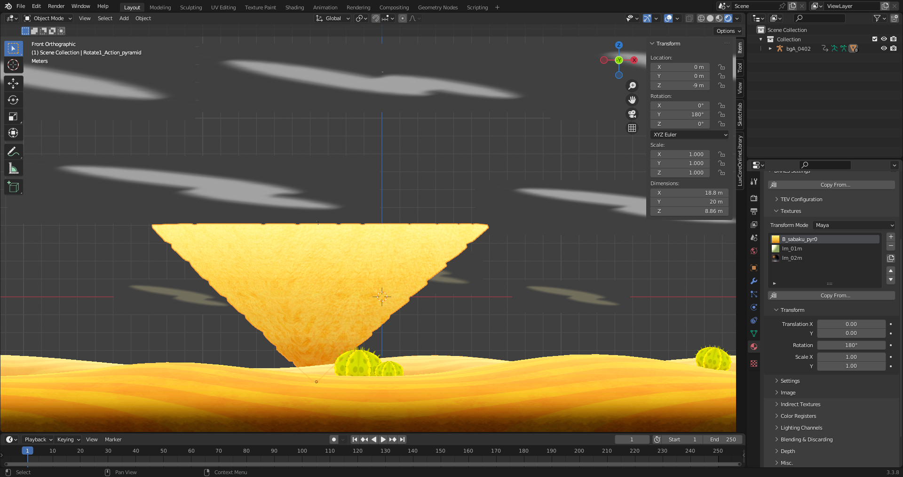

And it's that simple! Let's open the TEV config back up and re-enable the other stages so that we can see everything accurately now.

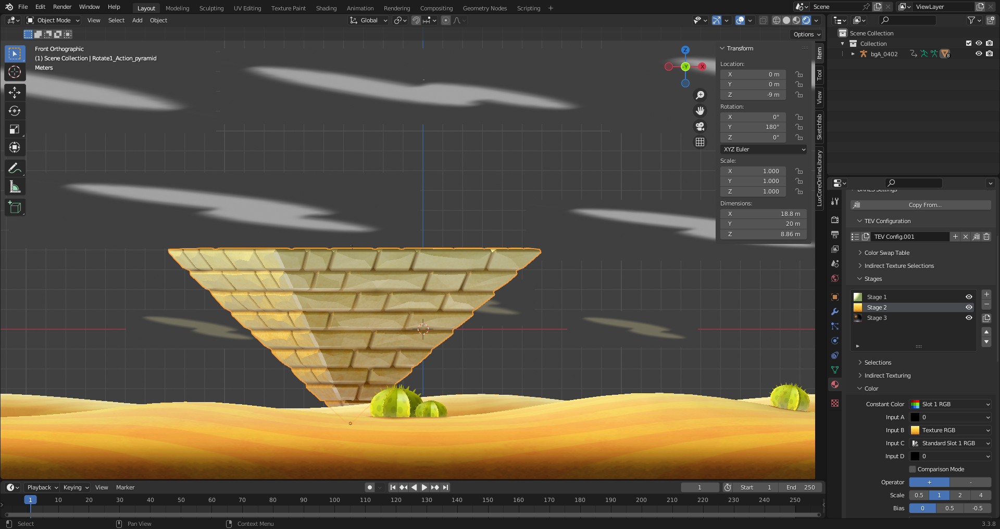

Not bad! You can go back to **Textures > B_sabaku_pyr0 > Transform** to change the rotation back if you'd like to do a comparison. If you prefer the version without the rotation, feel free to keep it that way. Now that we've learned the basics of textures, though, there's one more thing we can fix: the imperfection in our lightmaps that I mentioned earlier. If you didn't follow the lightmap importing process, you can skip these next two paragraphs.

If you check out the **Image** panel for either of the lightmap images, you'll see that the format is set to **I8**. This format, as mentioned earlier, only supports grayscale images, so our lighting doesn't have any color. The format used for the lightmaps ingame is **RGBA8**, so you can switch to that on both images to restore this color detail. You can also use **RGB565** if you'd like, since that's a more compressed alternative with practically no quality loss in this case. Since this format is just for the placeholder images, it does not affect how the lightmaps appear ingame.

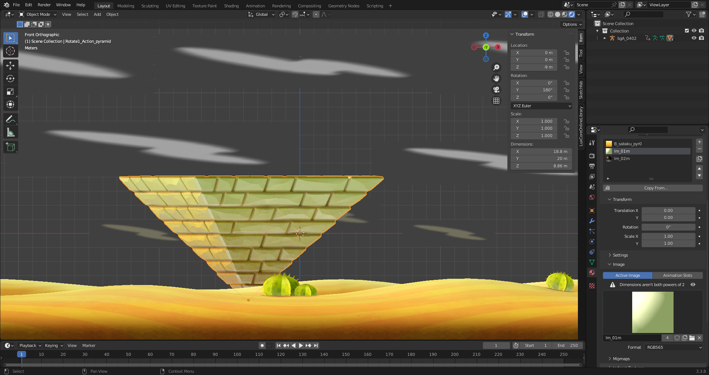

Another thing you'll notice here is the same warnings that the verifier was giving us earlier. If you click the eye icons to the right of the warnings on both images, this will suppress those warnings so that the verifier will no longer report them. (Instead, it will just say the number of warnings suppressed, in addition to the regular number reported) When running the verifier, you can optionally bypass this suppression to report all warnings.

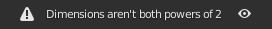

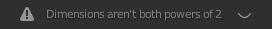

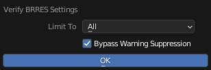

So what else lies in the material interface? A lot of the things you'll find here are other features (like textures) that can be used as TEV inputs, such as the **Color Registers** (which each store an animatable color value) or **Lighting Channels** (which provide access to vertex colors, among other things). There are also **Indirect Textures**, which are a complex beast outside the scope of this tutorial (not used in this model). Finally, there's **Depth**, which lets you configure the depth test (a standard feature in 3D graphics which determines how things are drawn on top of one another), and **Blending & Discarding**, where you can configure features like blending, culling, and the alpha test. Some of these features will be covered more in the next example. For full details, check out the [[ Materials | Materials ]] page.

For now, we'll make a quick change to one of the color registers, just for the sake of seeing how these other properties can influence the output. The color registers are kind of like textures, except that they're just single colors. Constant Color Slot 4 is used by this particular TEV configuration to add a tint to the final output color (which you can figure out from the stages, but we'll get into that more in the next example), so let's mess with that to tweak our pyramid a little more. Feel free to go crazy here. A bit of green was added in this image for some kind of an alien vibe.

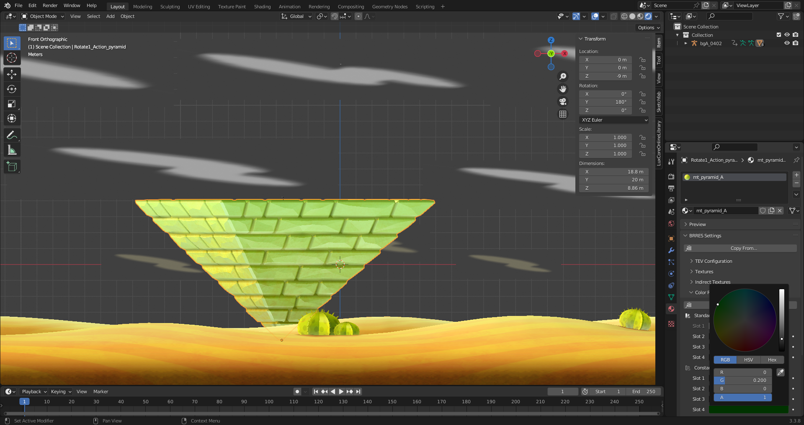

Anyway, now that we've made our material edits, let's export our model again with **File > Export > Binary Revolution Resource (.brres)**. Before you click **Export BRRES**, though, let's make a quick tweak to the settings.

You might be thinking that restarting the game every time you want to edit a model seems obnoxious, and that's absolutely right. Unfortunately, in most cases, replacing files while the game is running leads to crashes. However, Riivolution in Dolphin does allow you to do this **as long as files don't change their sizes**. To take advantage of this, BerryBush has an export option called **Pad To** that lets you set a fixed file size so that you'll be able to make changes and test them out without all of the waiting. All you have to do is replace the file and then reload the model ingame; for instance, in our case, you simply have to exit the level and then re-enter it.

**Warning**: If an exported file's size exceeds the target size, the target will be ignored and this feature will do nothing. Ensure that when utilizing padding, you give your files plenty of extra space.

**Warning**: Generally, this does not work on console. In that case, [[ RiiFS | https://horizon.miraheze.org/wiki/Loading_Files_Over_the_Internet ]] should be used.

Anyway, let's add some padding to our model to make testing easier. Our last export was 1.03 MB (using BerryBush 1.0.0 - may differ in later versions), so let's just double that and go with 2 MB for the goal size. This should be more than enough extra space, so everything will be fine even if we add a ton of stuff to our model. Once we're done making changes, we can re-export with padding disabled to get back our precious Wii memory. We won't be doing that in this tutorial, but it's something to keep in mind.

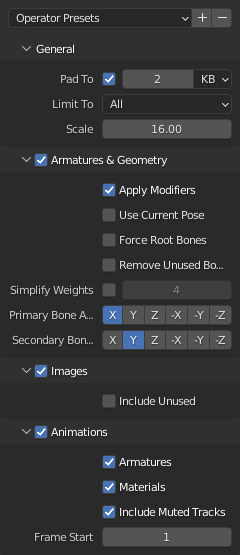

With that, let's check our model out in game! If you're using Dolphin, this should be the last time you have to restart it, as you'll be able to just leave it open from here on out.

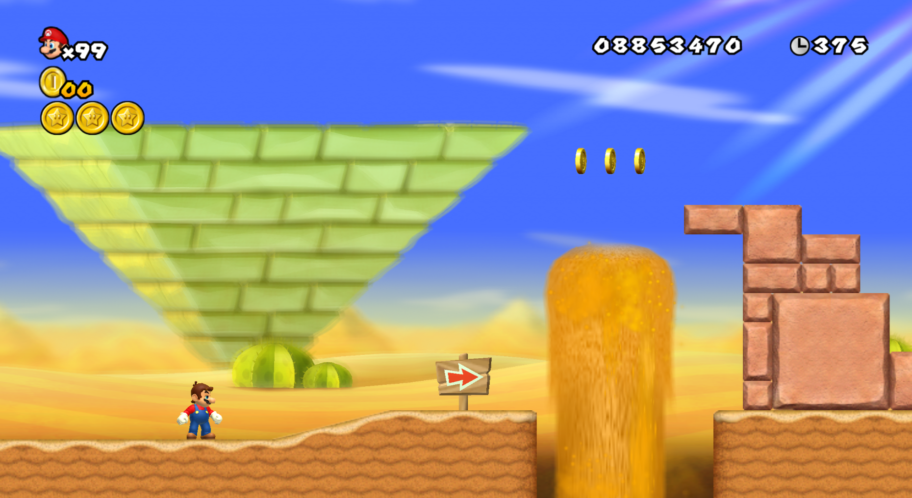

That's certainly something. What if we want to change the color now? All that we have to do is switch things up in Blender, export with padding, and then reload the level, and now we have:

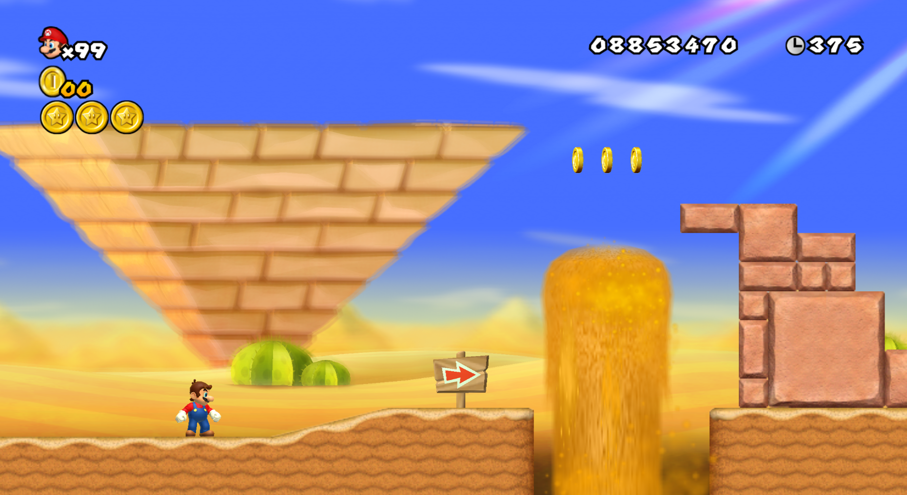

A reddish tint, which I like because it kind of matches the blocks in the tileset. It could use some improvement, and the best way to make these edits would've honestly been to just edit the main texture (because this method affects lighting as well), but now we've seen how to experiment. Don't be afraid to mess with all of this stuff and keep exploring!

That's it for the pyramid tutorial. The next example will cover materials in much greater detail, give you experience making BRRES models from scratch, and go into the basics of animation import & export. See you there!

# Example 2: POW Block

## Initial Material Setup

For this example, we'll be replacing the POW block with Blender's default cube. First, make a new Blend file and save it so you won't lose your progress. Set up the scene settings like last time:

Now, let's get to work. If you made your new file using Blender's default template, you should already have a cube. If not, you can add one in the 3D viewport using **Add (Shift + A) > Mesh > Cube**. By default, this cube will appear as pure white in the BerryBush render engine:

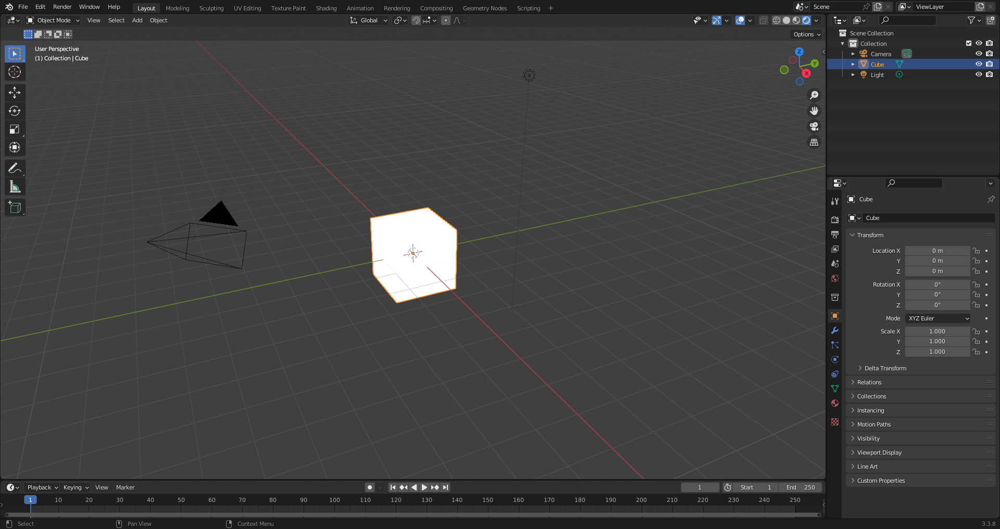

Our first goal will be to change this color. Select the cube and head to the **Material Properties** panel so that we'll be able to tweak the BRRES settings. Our first concern will be the **TEV Configuration**, so expand the corresponding panel.

Note: If you added a cube yourself (rather than having it from the default scene), it won't have a material set. You can add a new one to use for this example.

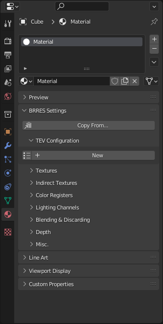

Our cube doesn't actually have a TEV configuration yet, so press **New** to add one. This causes the cube to turn black. We'll get into why that happens in a little bit, but for now, let's explore the interface.

Like in the last example, we'll only be focusing on the **Stages** here, as the **Color Swap Table** and **Indirect Texture Selections** are both minor features that you can read about in the [[ main material documentation | Materials#tev-configurations ]]. As previously mentioned, each stage defines one color & alpha calculation, and they're run sequentially for each pixel on an object being rendered. A stage takes inputs from a variety of sources (including textures, vertex colors, and more), and then performs computations using those inputs to get some output color, which can then be used as an input for another stage (or the final output). A TEV config always has at least one stage. Open the **Stages** tab to check it out.

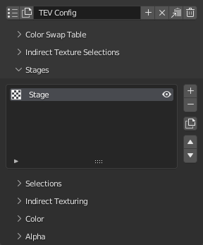

The stage UI is split into 4 tabs. The first is **Selections**, where you can choose the sources of some of the inputs mentioned earlier (e.g., you can choose which texture a stage should use). The second is **Indirect Texturing**, which is beyond the scope of this tutorial (check the [[ material documentation | Materials#indirect-texturing ]] for more info). The tabs that we care about for now are the last two, which define the per-pixel calculations for color and alpha (transparency), respectively. Open the **Color** tab so that we can start defining our color function.

Each TEV calculation takes in 4 inputs, called A, B, C, and D. Each of these inputs can take its value from a variety of sources. These are all combined in an equation displayed at the bottom of the computation interface, which you can tweak using the other settings. For now, we'll keep them at their defaults, making the equation `Output = Clamp(1 * (0 + D + lerp(A, B, C))`, which simplifies to `Output = Clamp(D + lerp(A, B, C))`. `lerp` here refers to linear interpolation, and `lerp(A, B, C)` can alternatively be thought of as `A(1 - C) + BC`. `Clamp` ensures that values stay within the range of 0-1. This is performed for each color channel.

So, what does "Output" refer to? Each TEV stage calculation's output is written to one of the **Color Registers**, which we briefly touched on earlier. Particularly, the TEV writes to the **Standard** registers, as opposed to the **Constant** registers (the sole difference between these register types being that the constant ones cannot be modified in this way). These registers can then be used as inputs for other stages. Three of the four can also have initial values before data is written to them (the exception being **Slot 1**, whose initial value is undefined and should not be referenced before being used as an output). The last slot with a value written to it is used for the final value, and it's recommended to use the aforementioned Slot 1 for this (a rule followed by nearly all models in NSMBW).

If a material doesn't have a TEV configuration, results on Dolphin/console are undefined, but BerryBush assumes output values of 1. This is why our cube was initially pure white, and switched to pure black (the result of our current color calculation, with all inputs set to 0) after we made our TEV config.

Looking at the TEV equation, you might notice that you can set the output directly by only using input D (leaving everything else at 0). For now, we're going to utilize this to make our cube's entire surface one color. So, we'll set input D to **Constant Color Selection**, which will let us choose a uniform color for that input. This option means that the input will get its value based on the computation's **Constant Color** field, which is set at the top of the interface. We'll keep it at its default of **Slot 1 RGB**, which refers to the first constant color register. Here's what our color settings look like now:

Now, if you expand the **Color Registers** panel (outside of the TEV Configuration interface) and modify Slot 1 under Constant Colors, you should see that our cube will change colors!

Our cube is looking great, but it's just one solid color. Let's add some detail with a texture. If you switch input D from **Constant Color Selection** to **Texture RGB**, our cube will use the TEV stage's texture selection rather than the constant color selection. As previously mentioned, this texture is chosen under the **Selections** tab of the stage UI.

By default, the first texture slot (in the **Textures** panel, which we checked out in the last example) is selected. However, our material doesn't have any textures yet, so Texture RGB is just giving us a black color right now. Let's add a texture to fix this.

Once we have our texture, the first step is to assign an image to it. Recall that "image" here refers to an image file loaded into Blender, and images are used by textures. Under the **Image** tab, you can choose an image that's already been loaded, open one from a file, or create a new one. You can use any image you want, but we'll create a UV grid to use for our cube in this example. To do this, you can press **New** and then choose **UV Grid** under **Generated Type**. The default dimensions (1024x1024) are pretty ludicrous for a Wii texture (actually, that's the **maximum size allowed**), so we'll bring that down to 256x256 (which is still quite large, but much better).

Just like that, our cube has a texture! Let's tweak some stuff now to improve it.

You might notice that our cube's looking a little blurry. We'll fix this by changing is the min & mag filters, under **Settings**. These decide how texture sampling should behave when textures have to be upscaled or downscaled, and they each have two options: **Linear** (soft & smooth) or **Nearest** (sharp & crisp). Since our image has a lot of sharp edges, we'll go with Nearest. Here's what that looks like:

Nice! The next thing we'll be changing is the image format. To decide which format is best for an image, it's recommended to start with **RGBA8** (highest quality, but worst compression) and then try everything else until you've found the most compressed format (fewest bits per pixel) with image quality that you deem acceptable. A little cheat sheet with all of the formats can be found [[ here | Materials#image-formats ]]. Our image looks good under **RGB5A3** (the default format), which uses 16 bits per pixel, but it's practically identical under **CMPR**, which only uses 4. CMPR can be **prone to artifacts** (our image gets some subtle ones around the + marks), so you may be uncomfortable switching to this format. If that's the case, **RGB565** would be another option to consider, though that takes up four times as much space. (For a 256x256 image, that's 32 vs. 128 KB) The decision is ultimately up to you, and it depends on **how much you can afford to increase your model's file size before running into memory issues on the Wii**. Since the CMPR compression artifacts are so subtle for this image, we'll just go with that format here.

## Preparing For Export

Our cube's coming along. However, we're still missing something crucial for BRRES export: **everything that you export needs to be involved in some form of armature or bone parenting**. In complex cases, armatures may be used for mesh deformation or setting up things like custom worldmaps. In cases like this one, this just means we need a single bone that will act as our cube's parent. So, let's add an armature to our scene and then parent the cube to its root bone (select both & then press **Ctrl+P > Bone**). Note that the bone may be hard to see as it'll be placed inside of the cube. This can optionally be remedied by enabling **In Front** under the armature's **Viewport Display** panel, though it's not done in the images here. Now that we've set up bone parenting, our model can be exported to BRRES.

However, before we add our cube to the game in place of the POW block, we should **make sure that it's transformed correctly**. For all we know, the POW block's model could be a hundred times the scale of our cube, and this thing would look tiny if we brought it into the game. So, let's import the vanilla POW block (`Object/block_pow.arc`) to check it out. Follow the process from the last example. Since we're just using this as a reference to check a few things, don't worry about the lightmaps here.

Looks like the vanilla model is a bit smaller than our cube, and it's also moved up. Let's alter our cube accordingly so it occupies the same space. You can do this through its Transform, or by editing its mesh directly (or transforming and then applying it). Any of these methods are fine for BerryBush.

**Warning**: Ensure that you're transforming the cube object, **not** the armature. Our armature is already set up properly. It's also worth noting that the transforms of armatures (unless applied through Ctrl+A) are entirely ignored during export in BerryBush, as everything is exported relative to them (though additional object transformations are taken into account).

Another crucial last step that we have to take is **renaming our armature object**. This should always be named after the armature you're replacing, or the game will crash when it tries to load your model. Since names have to be unique in Blender, we'll rename the imported armature (previously `block_pow`) to `Vanilla Import`, and then give the name `block_pow` to our custom armature.

There we go. Now, let's export our model. We don't want to include the original POW block, so we have a few options for excluding it from our export. Both options take advantage of a BRRES export setting called **Limit To**. One is to select the custom model, and then set **Limit To** to **Selected**, which will make it so that only selected objects (and their armature parents) are exported. The other is to hide the retail model & armature (which can be done in one click by holding **Shift** when hiding the armature) and then set **Limit To** to **Visible**, which will make it so that only visible objects (and their armature parents) are exported.

With that, head to **File > Export > Binary Revolution Resource (.brres)**, choose the appropriate option for **Limit To**, and export. Then, for your future self's convenience, check the size of the exported file, add a bunch to that, and export again with padding. Our first export got us to 36.3 KB  (using BerryBush 1.0.0 - may differ in later versions), so let's just pad to 100 for plenty of room to grow.

Now, let's replace the model and check it out ingame!

...Yikes. As soon as our model is about to show up on the screen, we get a crash. Generally, if this isn't because the game ran out of memory, it's because **there is something in the original model which the game is failing to find in your replacement**. When this happens, here are a few steps you can follow to troubleshoot:

- Import & export the vanilla model without making any changes (and with the default import/export settings) and test the result ingame. If you get a crash at this step (and none of BerryBush's [[ known limtations | Scope-and-Limitations#current-limitations ]] are applicable), this is a BerryBush bug. Please don't hesitate to reach out about it.
- Start making edits to the vanilla model import to slowly turn it into your model. Test each change ingame. Once you have a version that crashes, you'll hopefully have a better idea of what's causing the crash.
  - Common culprits include naming differences (e.g., some models have requirements regarding bone names) and missing resources (usually animations)

Our case falls into that "missing resources" category. The POW block uses an animation which our model currently lacks, and that's causing our crash. For some models in NSMBW, not including animations is okay, but for others, it will cause issues. Let's head to the **Animation** workspace to learn about what we need to add.

## Animations

Animation import & export with BerryBush is controlled through the **NLA Editor**. If you haven't used the NLA Editor before, be sure to familiarize yourself with its basic features for a moment before diving in. Let's pull that up, and let's also hide our cube & its armature for a moment to prevent them from getting in the way. If the vanilla POW block is hidden, bring it back. We're trying to find out exactly what was imported with it.

Once you've done all of this, your screen should look something like this:

So, what exactly are we looking at here? The first thing to understand is that there are 5 BRRES animation formats supported by BerryBush, each corresponding to a type of model property. These formats are as follows:

- CHR (bone transforms)
- VIS (bone/object visibility)
- CLR (material color registers)
- PAT (which images are used by textures)
- SRT (texture transforms)

Each animation is imported via an NLA track with a single action strip on the ID it targets. For instance, as we can see in the NLA editor, the `block_pow` armature from the vanilla POW model has one NLA track called `down`. To export a replacement animation, we'll have to make a track on our custom armature **with the same name that corresponds to the same BRRES format(s)**. First, we'll have to figure out what this animation targets to get a better idea of which format(s) we'll need. Let's preview it in Blender for a better idea of what we're dealing with. To make the playback speed match the ingame speed, set the scene's **Frame Rate** to 60 FPS. Then, solo the NLA track and press play.

This animation is a bit chaotic, as it's what gets played when the POW block is activated and sends out its shockwave. The important thing to note about it is that it seems to control bone transforms (particularly, the scale of the POW block's parent bone), so we're probably dealing with the CHR format here. Let's check out the F-Curves at play to find out exactly what properties this animation is targeting and confirm our hypothesis.

Set the active action of `block_pow` to `down`.

Then, open up the **Graph Editor** so that we can check out this action's F-Curves. Disable **Only Show Selected** at the top of the Graph Editor to ensure that we're able to see everything.

All of these curves involve bone transforms, which means that this animation must've come from a CHR animation. Alternatively, we could've checked this in BrawlBox. Here, you can see that there's one CHR animation called `down` in the original `block_pow.arc`:

So, when we export, we'll need to also export a CHR animation called `down`. Here's how we'll do that:

When BerryBush exports a model, **every NLA track on every exported material and armature object is checked for possible conversion to BRRES**. The first strip on the NLA track must be an action strip. Then, if that strip corresponds to some BRRES format, the export process begins. A single action can correspond to multiple formats, and BerryBush will automatically split up the animation data. The resulting BRRES animations are named after the NLA tracks from which they were exported.

So, we'll need to make an action that targets bone transforms and put that on an NLA track called `down` on our custom armature.

**Warning**: We only had CHR here, but there could've also been animations called `down` that corresponded to other formats. If that had been the case, we might have needed to include other types of animation data in our action.

Let's get started on this. First, bring back our custom stuff, and hide the vanilla model import. Then, select our armature and enter pose mode so that we can give it some bone animation data.

With the root bone selected, press **I** to insert a keyframe, and select any of the available options. For now, we won't be making anything move; we're just making an action that will get BerryBush to create a CHR animation for us.

Once you've done this, you'll see that an action has been created in the NLA editor. Press **Push Down Action** to move this action to its own NLA track.

Then, rename this NLA track to `down`. And with that, you're done! Since the action modifies bone transforms, BerryBush will export a CHR animation called `down` for it. This animation is only a single frame long and doesn't actually do anything, but it'll be played whenever a POW block is activated, and it'll prevent our model from crashing the game. Now, we're finally ready for our export (for real this time).

Using the same settings as before, let's export our model and bring it into the game.

Success! Our cube's looking great. It could be better, though. Rather than using a single emissive texture for its surface, let's tweak this thing to make it affected by lighting.

## Lighting

Let's get back into our cube's material's settings. The first thing we'll have to do is add lightmaps. Create two new textures, and choose `lm_01mo` and `lm_02mo` for their images. These are already in our scene because we imported them as part of the vanilla model, but if they weren't, we would just have to add two new images and give them those names. You can name the textures as you please. Once you've done this, your texture list should look something like this:

Optionally, you can follow the steps from the last example to import better lightmaps. Then, your texture list will look something like this:

Now, let's edit our TEV configuration to apply these to our model. We'll structure this in a similar way to the config from the vanilla import, with a few simplifications. Essentially, we have a main texture, a diffuse lightmap (lm_01mo), and a specular lightmap (lm_02mo). Our end goal is to have a color equation that looks like `(main texture) * (diffuse lightmap) + (specular lightmap)`. We'll accomplish this with three TEV stages (one for each texture).

The first step is just applying the main texture as we're already doing, so we'll keep the first stage the same. Just rename it to something a little more descriptive.

We'll use the next stage to apply diffuse lighting. We'll do this by multiplying the diffuse lightmap texture with the result of the previous stage. Set the texture slot for this stage to 2, and then use inputs B and C to achieve this multiplication. (Remember that `lerp(A, B, C) = A(1 - C) + BC`, so our equation with A and D set to 0 works out to `Clamp(1 * (0 + 0 + 0(1 - C) + BC)))`, which simplifies to `Clamp(BC)`). Since our last stage wrote its output to **Standard Color Slot 1**, we can use that for one of our inputs and **Texture RGB** for the other. Our equation now boils down to `(main texture) * (diffuse lightmap)`.

All that's left now is taking our current result and adding the specular lightmap texture to it. For the third stage, set the texture slot to 3, and then use inputs A and D for the addition. (With B and C set to 0, `lerp(A, B, C)` is just equal to A, so we have `Clamp(1 * (0 + D + A))`, or `Clamp(D + A)`). Again, since our last stage wrote its output to **Standard Color Slot 1**, we can use that for one of our inputs and **Texture RGB** for the other. Now, we've achieved `(main texture) * (diffuse lightmap) + (specular lightmap)`, the equation we were looking for.

We have lighting! Unfortunately, though, it's looking a bit... crusty. Let's take a brief detour to find out why that is.

Blender supports two distinct types of geometry attributes: generic attribute layers and UV maps. BRRES also supports two distinct types of geometry attributes, with room for up to 2 color attributes (used by lighting channels) and 8 UV maps (used by textures). Under **Object Data Properties > BRRES Settings**, you can configure which Blender layers should correspond to which BRRES slots. Taking a look at our cube, we can see that it has one UV map (generated automatically by Blender when it was created), and this is automatically assigned to the first BRRES UV slot.

So far, **all of our textures have been getting mapped based on this first UV slot**, which points to `UVMap`. If we added more UV maps of our own, we would have to enter their names in other BRRES slots to be able to use them for textures. You can also use non-UV layers for these slots, or use UV layers for color slots. Both types of Blender attributes can be used for either type of BRRES attribute.

To use another slot for a texture, you can change its **Coordinate Source**. Let's try setting the coordinate source of our main texture to the second slot instead of the first one:

Since we don't have a UV map assigned to the second slot, the coordinate (0, 0) is just used for our entire cube. If we assign our original UV map to the second slot, however...

Now, we're back to normal. The only difference is that our main texture is technically getting mapped based on the second UV slot rather than the first one (but this doesn't matter, as they point to the same Blender layer).

Anyway, we don't actually need two UV slots for our model, so you can clear the second one and reset the coordinate source on the main texture. Looking at the list of coordinate sources, you might've noticed that although there are only 8 UV slots, there are more than 8 options in the list. That's because **some things aren't meant to be mapped using UV coordinates**. NSMBW's lightmaps are an example of this, which is why our lighting has looked so wrong so far. These textures are intended for use with a coordinate source called **Environment Map (Camera)**, which relies on geometry normals and the camera position. Select this on both lightmaps, and:

That's the kind of lighting we've been looking for. Let's check out this new & improved version of our model ingame.

Looking good! The difference is subtle for this cube, but lighting is a big deal for larger models. Here's another screenshot in a different environment for fun:

Now, let's continue to tweak our cube by exploring some of the other material settings.

## Even More Material Stuff

We've developed a solid grasp on how the TEV works, so let's check out some of the other stuff that we didn't really touch in the last example. The first thing we'll look at is the **Lighting Channels**.

Most features related to lighting channels are not used in NSMBW, so they're not currently well-documented in BerryBush. The important thing to know about these is that they allow for the use of vertex colors in the TEV. A material can have up to two lighting channels, each corresponding to one vertex color slot. Let's add vertex colors to our cube and then apply them as a "filter" for the main texture by multiplying it with them.

Under the **Object Data Properties** panel, add a vertex color attribute. You can name it as you please.

In the 3D viewport, switch to **Vertex Paint** mode so that we'll be able to edit these colors. With the Viewport Shading set to **Solid**, select **Attribute** for the Color property in the viewport shading menu. This will allow you to preview the vertex colors.

Then, paint the vertices with whatever colors you'd like. Once you're satisfied, head back to **Object** mode and open the **Material** panel.

To access these colors in the TEV, we'll need to create a lighting channel. Expand **Lighting Channels** and add one to our material.

Each lighting channel contains two color registers: diffuse and ambient. The color produced by a lighting channel is equivalent to its diffuse color, optionally multiplied by its ambient color if the **Diffuse Lighting** checkbox is checked. Each of these colors can either be set to a constant value, or to the values from the lighting channel's associated vertex color layer. Uncheck the checkbox by the **Diffuse Register** to make this channel use vertex colors in place of its diffuse register. Leave **Diffuse Lighting** unchecked so that the ambient register will be ignored. Now, **this lighting channel's output will come directly from our vertex colors**.

Unfortunately, this creates a warning because we haven't actually picked which mesh attribute to use for this lighting channel yet. Let's head back to the **Object Data Properties** for this. As previously mentioned, each lighting channel corresponds to a BRRES color attribute. The first one corresponds to slot 1, and the second (if it exists) corresponds to slot 2. Let's set slot 1 to the name of our color attribute.

Now, if we head back to the **Material** settings, we'll see that this layer has been recognized by our lighting channel.

At this point, we're ready to reference our vertex colors in the first TEV stage. This is similar to referencing textures, and it's done through something called the **Raster Color**. First, let's make it so that this raster color comes from our lighting channel by selecting it under **Selections**. Then, we'll edit the TEV calculation to apply the filter we were talking about earlier. As a reminder, our goal is to multiply the texture & raster (lighting channel) colors. We'll use inputs B and C for this, similarly to how we used them in the second stage earlier. Reset input D to 0, and then set B and C to **Texture RGB** and **Raster RGB**. Now, our TEV has been reconfigured for the effect we were looking for. Switch the **Viewport Shading** back to **Material Preview** or **Rendered** to see how our cube's looking.

Our tints have been applied! With that, we're almost done messing with this cube. We just have one more effect to cover: translucency.

Transparency & translucency effects are typically achieved using a material's alpha channel. Recall that alpha is calculated separately from the main color. Let's edit our TEV configuration to send a constant alpha value of 0.5 so that our cube will be see-through.

Unfortunately, our cube is still rendered as opaque. That's because although we've set the alpha value, we haven't told our material what to actually do with it. This can be configured under the **Blending & Discarding** panel.

This panel gives us a lot of options for discarding fragments (pixels) before they're drawn or combining them with what's already been drawn. The feature that we're looking for falls into the second category, and it's called **Blending**. This is a standard feature in 3D graphics, and details about it can be found [[ here | https://learnopengl.com/Advanced-OpenGL/Blending ]]. Once we enable it, we get immediate results:

However, this isn't quite perfect. If you move the camera around our cube, you may notice that certain surfaces seem to arbitrarily occlude (hide) other ones, creating an inconsistent picture. In the image above, there's nothing visible behind the top surface, even though other sides of the cube can clearly be seen through its other surfaces. This is because of something called the **Depth Test**, another standard 3D graphics feature that can be configured under the **Depth** panel. (More info [[ here | https://learnopengl.com/Advanced-OpenGL/Depth-testing ]]) For opaque objects, the depth test is essential for ensuring that overlapping objects are drawn properly in front of one another. For translucent objects, however, it can cause problems like this. So, let's disable this test, which fixes our issue:

Great! Just a few more things now. This next one is subjective, but sometimes, we might not want the other sides of our cube to be visible when looking through it. We can fix this via **Culling**, which is used to prevent either front faces, back faces, or both from being drawn. If this is set to **Back**, the inside of our cube will no longer be drawn, so it'll become completely clear:

This should've actually been enabled anyway, as it would've been wasteful to draw the inside of our cube when it was opaque. **Generally, culling should be set to "Back"**. However, now that the cube is translucent, we have the option of keeping it this way or going back to the way it was before. For the sake of making the see-through aspect a little more tangible, we'll switch it back to **None** here, but you can do as you wish.

Another thing we have to look out for is the **Translucent Render Group** checkbox. Due to the nature of translucent objects, the order in which they're drawn matters, and they should always be drawn after opaque objects. Ticking this box puts them in a group that ensures they'll always be drawn after objects which have it unchecked. This order can be manipulated with greater precision via the **Draw Priority** per-mesh setting, but we won't get into that here. More details on this can be found on [[ this page | Materials#meshes ]].

Now, our cube's ready to go! Let's check it out ingame:

It's not the prettiest thing ever, but that looks like success to me. And with that, it's time to wrap up the POW tutorial. At this point, we've covered most of the core BRRES concepts, but there's only so much that we can get to on one page. For more details, you can always check out the rest of the wiki (reading over the [[ import | Import-Options ]]/[[ export | Export-Options ]] options is particularly recommended before starting on your own), and keep experimenting as much as you'd like to get a better feel for working with this addon. As a reminder, all kinds of feedback are welcome on [[ the issues page | https://github.com/hayden0729/berrybush/issues ]], and if you have any questions, don't hesitate to reach out to me on Discord (@hayden0729) in [[ Evolution | https://discord.gg/aZAaXVJ ]] or [[ Horizon | https://discord.gg/XnQJnwa ]]. Happy modeling!