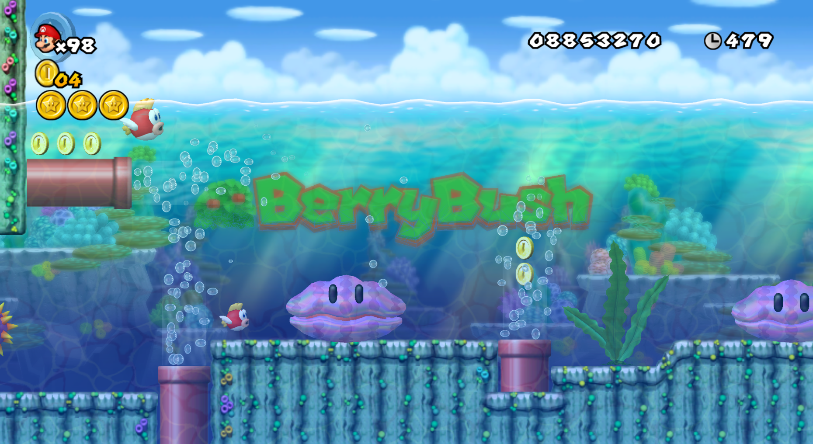

Welcome to the BerryBush wiki!

In addition to the tooltips within Blender, this is where you can find everything you should need to know about using this tool. All of the wiki's guides are available below, as well as on the sidebar.

Be advised that this is not a Blender tutorial. If you haven't used Blender before, familiarizing yourself with the software is highly recommended before diving in.  The guides here also assume a basic understanding of using Riivolution to replace game files. If you're new to this, you can learn about it [[ here | https://horizon.miraheze.org/wiki/Installing_and_Playing_Mods ]].

You can get started by checking out the summary of BerryBush's current [[ scope & limitations | Scope-and-Limitations ]]. Then, if you haven't already, you can follow the steps on [[ this page | Installation ]] to install the addon. Once you've done that, consider heading [[ over here | Getting-Started ]] to learn the basics.

This version of BerryBush can also load, edit, preview and save the game's scene lighting: the lights, light maps, fog, depth of field and bloom that every level and world map is drawn with. Head [[ over here | Scene-Lighting ]] to learn how it works.

## Guides

- [[ Scope and Limitations | Scope and Limitations ]]
- [[ Installation | Installation ]]
- [[ Getting Started | Getting Started ]]
- [[ Materials | Materials ]]
- [[ Animations | Animations ]]
- [[ Import Options | Import Options ]]
- [[ Export Options | Export Options ]]

## Scene Lighting

- [[ Scene Lighting | Scene Lighting ]]
- [[ Light Sets | Light Sets ]]
- [[ Lights | Lights ]]
- [[ Light Maps | Light Maps ]]
- [[ Fog | Fog ]]
- [[ Depth Of Field | Depth Of Field ]]
- [[ Bloom | Bloom ]]