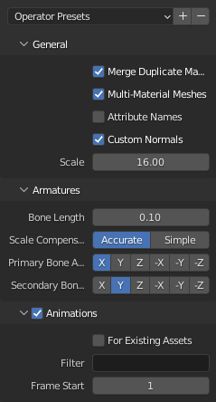

# General

### Merge Duplicate Materials

BRRES models are divided into MDL sub-files, each of which has its own skeleton, objects, and materials. Every MDL in a BRRES corresponds to one imported armature. For instance, Mario's model (`Object/Mario.arc`) is split up into 10 different MDLs, so it's imported as 10 different armatures. Because every MDL has its own materials, a single material may be duplicated multiple times throughout a BRRES file if it's used in multiple MDLs. If enabled, this setting combines those duplicates into just one Blender material.

### Multi-Material Meshes

Unlike Blender meshes, which support multiple materials, BRRES meshes can only have a single material assigned. However, certain naming conventions used within NSMBW's BRRES files can be used to detect & recover meshes that are meant to be joined together (but presumably, became split up on export). Models exported by BerryBush also follow this convention so that this detection will also work for re-imports. This setting results in much cleaner model imports, and it's recommended to leave it on.

### Attribute Names

This setting enables importing the names of color attributes & UV maps. These names are typically junk in NSMBW's BRRES files, so this is disabled by default.

### Custom Normals

This setting enables importing of normal data for meshes. If disabled, Blender will recalculate normals automatically, which may lead to worse-looking results for meshes with poor exported topology.

### Scale

Import is scaled down by this factor. Recommended values are 16 for most models and 30 for worldmaps, as these values result in 1 "tile" being equivalent to 1 Blender unit.

# Armatures

### Bone Length

While Blender bones are made up of two points (head and tail) each, a BRRES bone only has one. When a BRRES bone is imported, the head is placed at this point, and the tail is placed according to this length and the [[ bone axes | Import-Options#bone-axes]].

### Scale Compensate Mode

BRRES bones have a feature called Segment Scale Compensate (borrowed from Maya) which allows them to not inherit their direct parents' scales, while still importing those of their grandparents. Blender has a feature called Inherit Scale that can be disabled for similar behavior, but this also disables the influence of grandparent scaling (and great-grandparent scaling, etc.), so results may not be exactly the same in all cases. The BRRES behavior can be replicated perfectly through setups involving constraints and empties, but this can make rigs more difficult to work with. Because the Inherit Scale method is often perfectly sufficient, this option lets you decide between that method (**Simple**) or the constraint method (**Accurate**). 

When importing a model that utilizes Segment Scale Compensate, it's recommended to import using both methods and then preview every bone animation using the NLA editor. If all of the animations appear identical between the two imports, then all you should need is the Simple rig. However, if the animations differ (which does happen on occasion), you might need the whole Accurate setup.

### Bone Axes

The Primary & Secondary Bone Axes decide how your model's bones should be re-oriented on import. Blender's primary and secondary bone axes are fixed to Y and X respectively, but BRRES models tend to follow different conventions, which can cause imported rigs to look strange. Here, you can set those conventions to fix this. As long as you use the same conventions when importing and exporting, **this has no effect on animation evaluation or deformation**, only the direction in which the bones physically appear to point within Blender. If the axes are set differently between import and export, this can occasionally create issues in cases where bones are used to transform other models (such as the "jnt_wing" bone in the Goomba model which determines how the Paragoomba's wings are placed), so it's best to stay consistent unless you really know what you're doing. If unsure, leave at the defaults.

# Animations

### For Existing Assets

By default, imported animations are assumed to be related to other data within an imported BRRES file. For instance, when an armature animation is imported, the BRRES being imported is searched and an action is created for each MDL in the file that could work with the animation. If this setting is enabled, that search is expanded beyond the BRRES and into the existing data in Blender.

One case where this is useful is for NSMBW's player animations, which are stored in a separate BRRES from the player models. To import these animations, you must first have a player model in your scene and then import the animations with this setting enabled.

### Filter

If a string is entered into this field, only animations with names containing that string will be imported.

### Frame Start

This adds an offset in frames to all animation so that it can be imported according to your chosen starting frame.