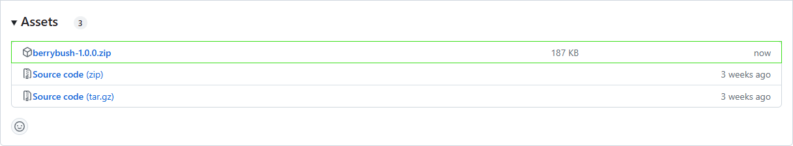
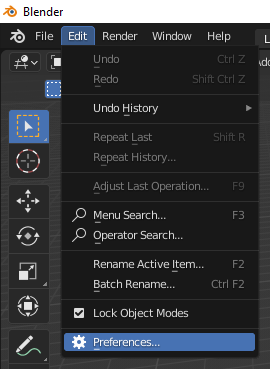
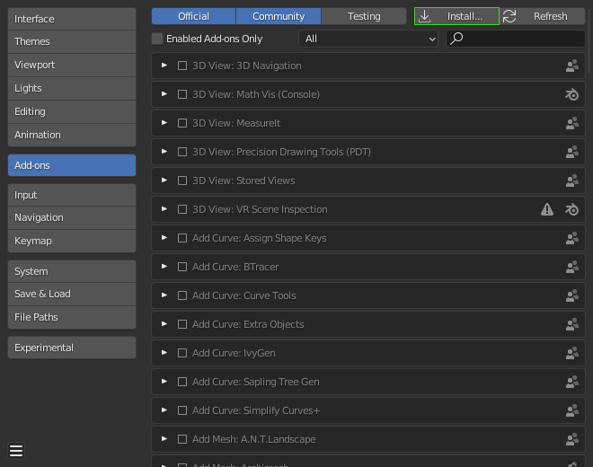
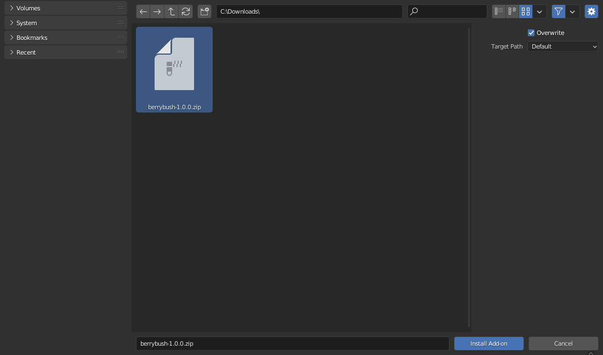
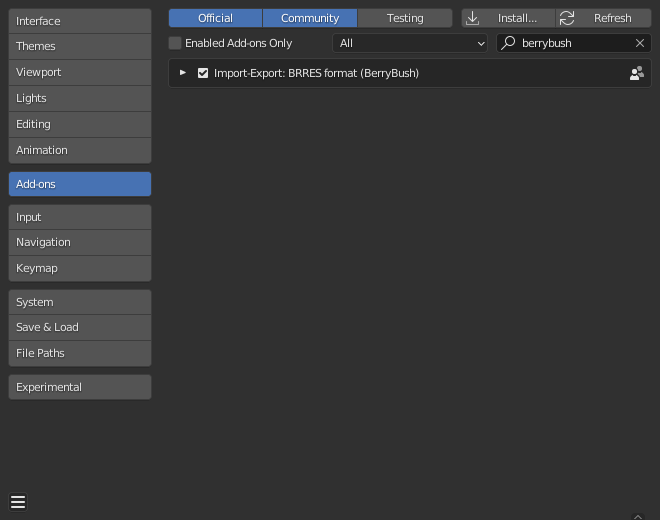
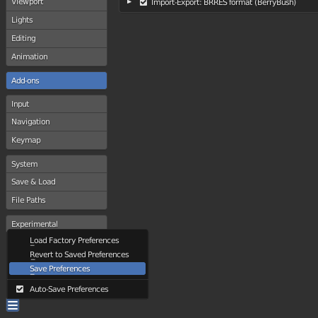

This quick guide will walk you through the BerryBush installation process. First, it's recommended to check [[this page | Scope-and-Limitations]] to ensure that you have a system and Blender version compatible with the addon.

***

1. Download a release [[ here | https://github.com/N-I-N-0/berrybush/releases ]]. Click on the ZIP containing the addon, **not** either of the "Source code" archives.

2. In Blender, open **Preferences**.

3. Navigate to **Add-ons** and click **Install**.

4. Choose the file you downloaded (do not extract it) and click **Install Add-on**.

5. Enable BerryBush by searching for it and then ticking the checkbox to the left of its name.

6. Save your preferences so that the addon will stay enabled the next time you open Blender.

BerryBush is now installed! You can disable it via the checkbox that you used to enable it.

***

To uninstall the addon, you can click **▸** to expand its preferences and then press **Remove**.

To update to a new version, you can follow these same steps and the old installation will be overwritten. **Be sure to restart Blender** after updating to ensure the new version is loaded properly.

Every change to BerryBush is released as a new build right away, and each release is named after its build number. Whenever a newer build than the one you have installed is available, BerryBush lets you know when you open Blender. You can check which build you have installed in the addon's preferences, where you can also skip a build or turn these update checks off.

You can proceed [[ here | Getting-Started ]] to start learning the basics.