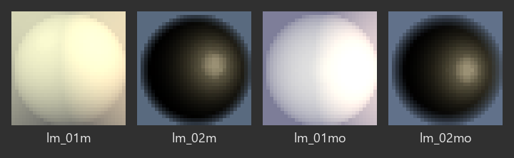
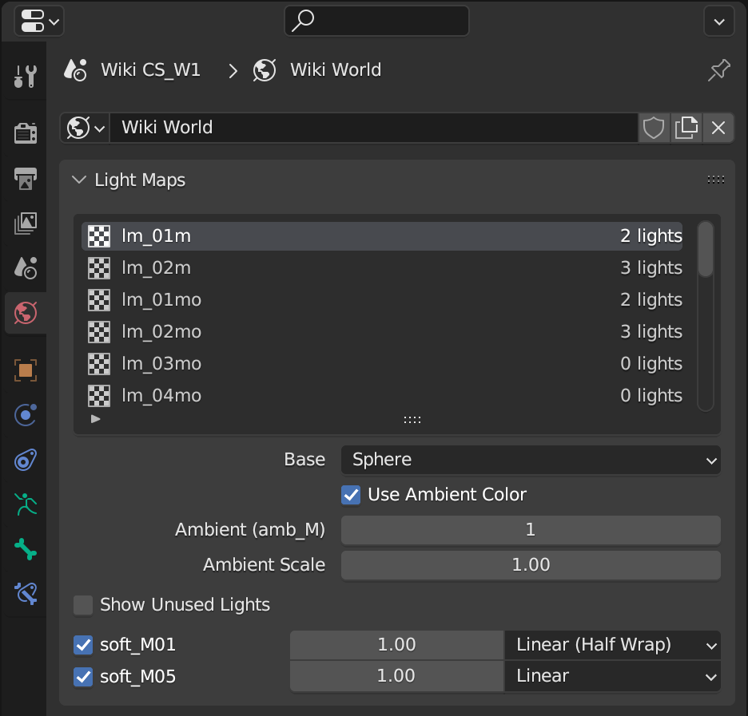
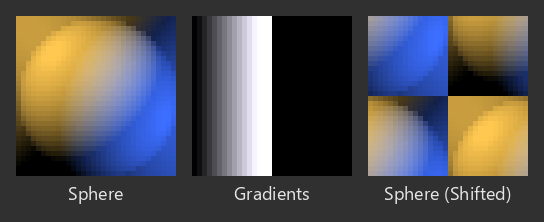
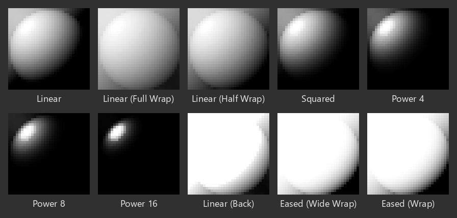
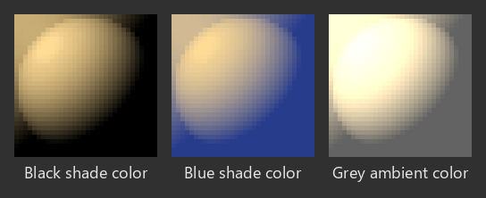
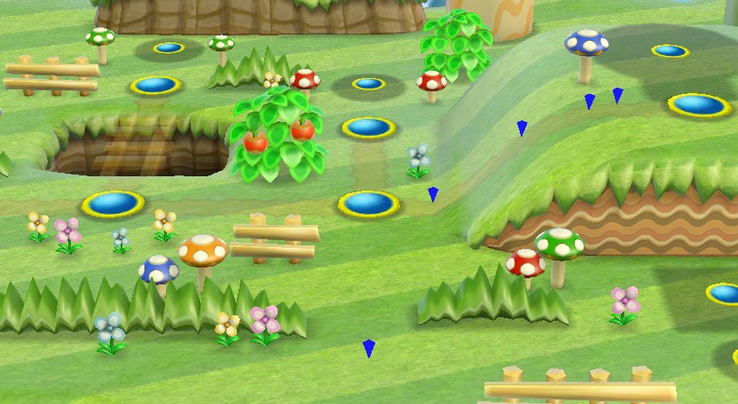
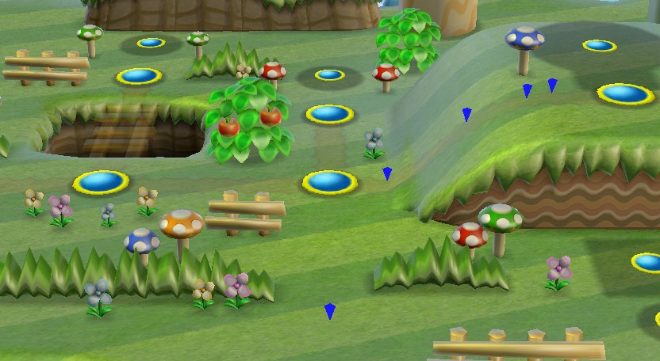
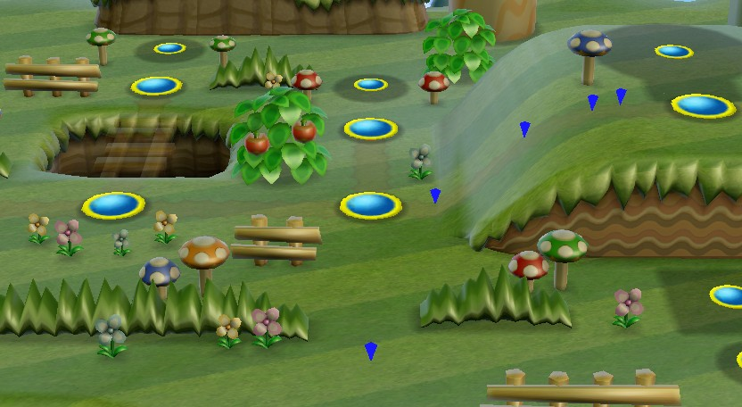

# Introduction

Most of NSMBW's shading comes from **light maps**: small textures (32 by 32 pixels) that the game draws from the scene's lights while it's running. A model uses them through ordinary textures whose images are named after a light map, such as `lm_01m`. The game swaps the generated light maps in for these images, so the images stored in models are just placeholders (the [[ Getting Started guide | Getting-Started#importing-lightmaps ]] has more on this).

The `.blmap` file of a lighting set describes these light maps. With a lighting set loaded, BerryBush generates them the same way the game does, and uses them in place of the placeholders in the viewport and in renders. The picture above shows the four light maps that the world 1 map uses, generated from the `W1` lighting set for the camera of the examples on these pages.

The names tell you what the light maps are for: `m` for the map, `mo` for map objects, `p` for players, `e` for enemies, `b` for bosses and `i` for items. The `01` light maps usually hold the soft, overall lighting and the `02` light maps the highlights, so a typical material multiplies its texture by an `01` light map and then adds an `02` light map. You can find the full list of names in [[ an image on the Horizon wiki | https://horizon.miraheze.org/wiki/File:Lightmap_Documentation.png ]].

This is how a light map is drawn:

1. It starts out black, or with an ambient color.
2. Each light that the light map uses adds a shaded sphere, which goes from the light's **Shade Color** on the side facing away from the light to the light's **Color** on the side facing it.

So a light map is a small picture of how a surface is lit for every direction it can face. Materials map light maps with coordinates based on their normals, which makes every part of a surface pick the lighting of the direction it faces. Since lights can depend on the camera (see **Space** in [[ Lights | Lights ]]), light maps change as the camera moves, and BerryBush redraws them for every view.

# The Light Maps Panel

The list shows each light map, along with the number of lights it draws. For the selected light map:

- **Base** decides the shape of the light map:
  - **Sphere** draws each light onto a sphere, as described above. Nearly all light maps use this.
  - **Gradients** lays the gradients of the first two lights flat over the texture, from left to right, instead of shading a sphere.
  - **Sphere (Shifted)** is the same as Sphere, but with the center of the sphere in the corners of the texture.
- **Use Ambient Color** makes the light map start out with an ambient color instead of black. **Ambient** picks it by its number (its name is shown next to it), and **Ambient Scale** sets its brightness.
- The list below has a row for each light that the light map draws. The checkbox turns the light on for this light map, the number is the **scale** of the light's color (its brightness in this light map, where the game ignores values above 1), and the last setting is the light's **gradient**. **Show Unused Lights** also lists the lights that the light map doesn't use, so you can add them.

A light also has to be enabled and have **Used By Light Maps** checked in the [[ Lights | Lights ]] panel to show up in a light map. Light maps only use the direction, color, intensity and shade color of a light, so its type and falloff settings don't matter here.

Here are two lights (a yellow one from the upper left and a blue one from the right) drawn with each base:

## Gradients

The gradient of a light decides how far its light reaches around the sphere. Here's a white light from the upper left with a black shade color, drawn with every gradient:

- **Linear** rises evenly from the edge (where a surface is at a right angle to the light) to the side facing the light.
- **Linear (Full Wrap)** rises evenly from the side facing away to the side facing the light, so it reaches all the way around.
- **Linear (Half Wrap)** rises evenly from halfway around the back to the side facing the light. This is the most common one for soft lighting.
- **Squared** and **Power 4** rise from the edge, more and more concentrated toward the light.
- **Power 8** and **Power 16** are a soft and a tight highlight facing the light, which are used for shiny spots.
- **Linear (Back)** rises evenly on the side facing away and is full from the edge on, so it lights everything but the back.
- **Eased (Wide Wrap)** and **Eased (Wrap)** ease in from behind the edge, and are full a quarter or a third of the way to the light.

## Shade & Ambient Colors

Here's the same light with a black shade color, with a blue shade color, and with a black shade color plus a gray ambient color:

The shade color fills the side facing away from the light, and blends into the light's color along its gradient. The ambient color is added everywhere, even in the corners outside of the sphere.

# Examples

Both of these change the light map `lm_01m` of the world 1 map, which most of its ground uses:

| W1 as in the game | `soft_M01` with **Power 4** instead of **Linear (Half Wrap)** | **Use Ambient Color** off |
| ----------------- | ------------------------------------------------------------- | ------------------------- |
|  |  |  |

With **Power 4**, the light only reaches the slopes that face it, so the rest of the ground gets darker. Without the ambient color, the light map starts out black, so everything the light doesn't reach gets darker as well.
