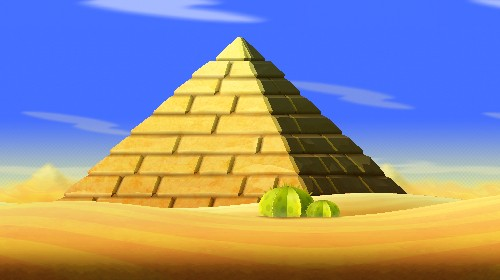
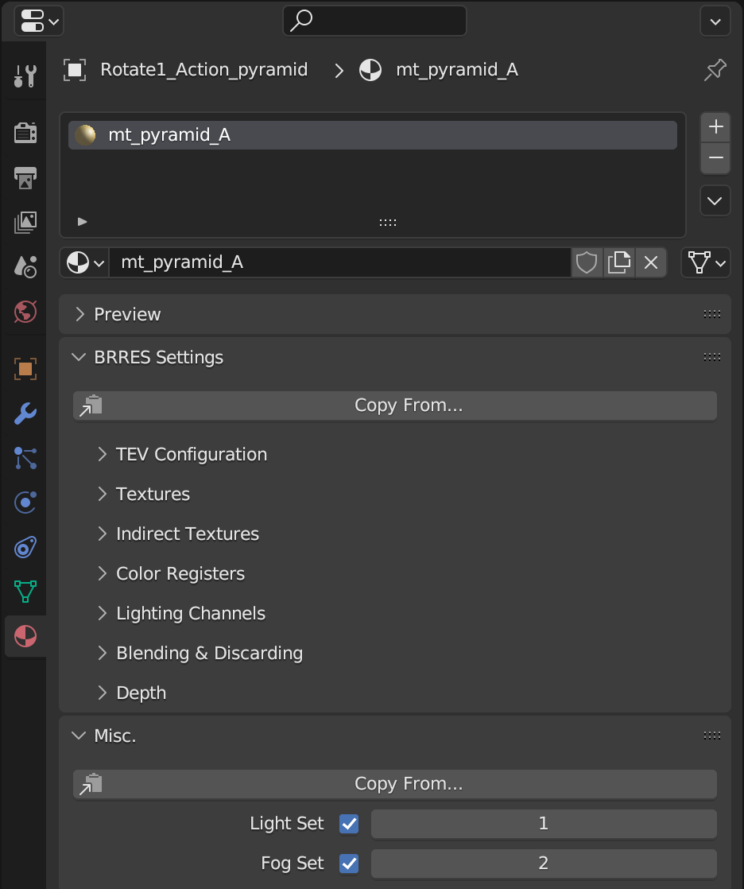
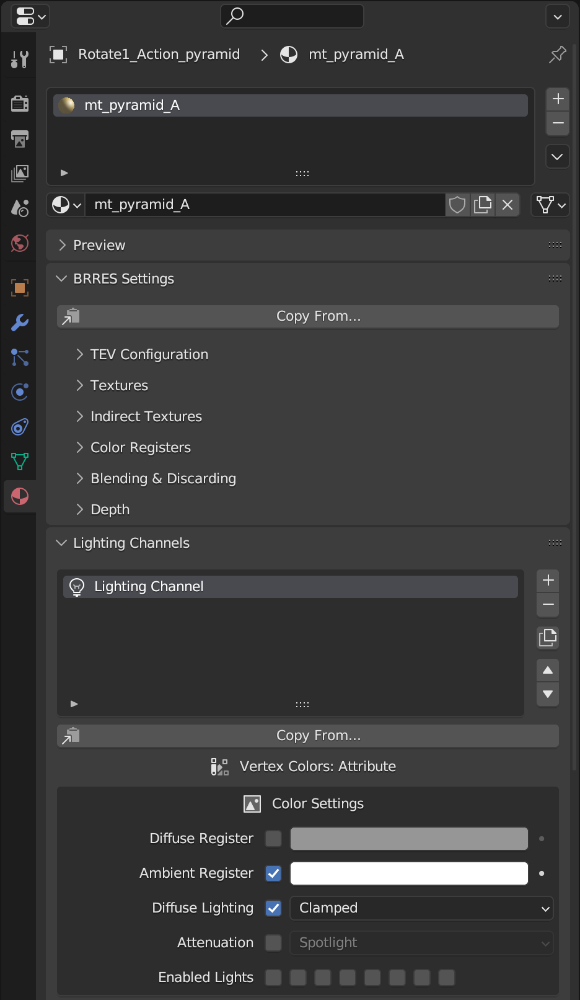
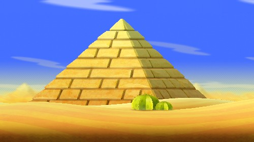
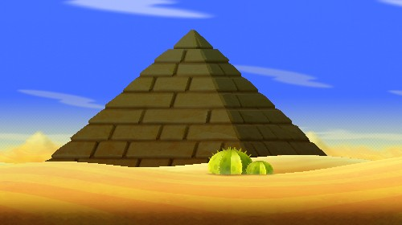
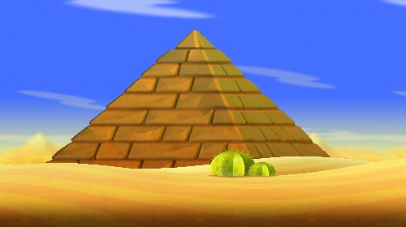
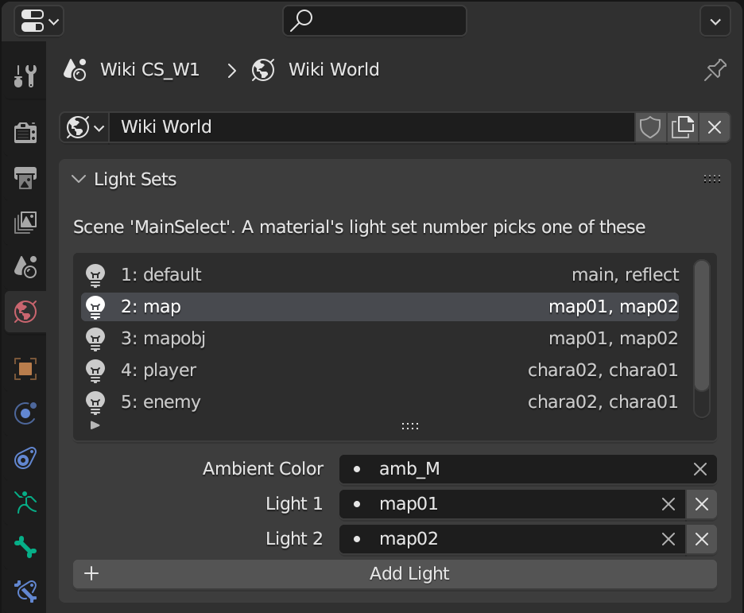
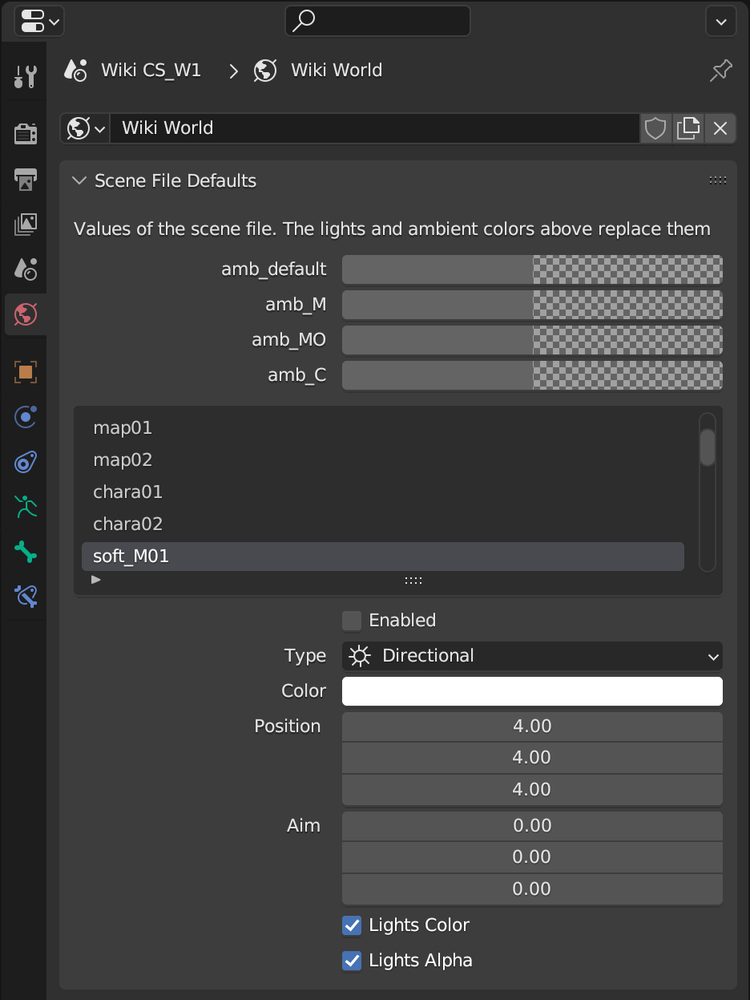

# Introduction

Every `Env` archive has a scene file, `scene/scene.brres`, with one scene inside it (`MainScene` in `Env_course.arc`, `MainSelect` in `Env_world.arc` and `MovieScene` in `Env_movie.arc`). The part of it that really matters to the game is its list of **light sets**.

A light set is a short list of up to 8 lights, plus one ambient color. Materials don't pick lights on their own. Instead, each material picks a light set by its number, and gets the lights and the ambient color of that set.

When a scene loads, the game first takes the lights and ambient colors of the scene file, and then the `.blight` of the lighting set replaces all of their values. So the scene file decides **which lights belong together**, and the `.blight` decides **what the lights look like** (see [[ Lights | Lights ]]).

These are the light sets of `Env_course.arc`:

| Number | Name | Ambient Color | Lights |
| ------ | ---- | ------------- | ------ |
| 1 | default | `amb_default` | `main`, `reflect` |
| 2 | map | `amb_M` | `map01`, `map02` |
| 3 | mapobj | `amb_MO` | `map01`, `map02` |
| 4 | player | `amb_P` | `chara02`, `chara01` |
| 5 | enemy | `amb_E` | `chara02`, `chara01` |
| 6 | boss | `amb_B` | `chara02`, `chara01` |
| 7 | item | `amb_I` | `chara01`, `chara02` |

`Env_world.arc` and `Env_movie.arc` have the first six of these, with `amb_C` as the ambient color of sets 4 to 6.

# Using a Light Set in a Material

A material picks its light set in **Material Properties > BRRES Settings > Misc.** with the **Light Set** setting. Light set 1 is the first set of the list, light set 2 is the second, and so on. If the checkbox is unchecked, the material uses no light set at all, so no scene lights reach it and its lighting channels keep their own ambient color. (**Fog Set** works the same way for [[ fog | Fog ]].)

A light set only affects a material through its [[ lighting channels | Materials#lighting-channels ]], and only if **Diffuse Lighting** is enabled on the channel:

- The ambient color of the first lighting channel gets multiplied by the ambient color of the light set.
- The lights of the set get added to the channel. How much of a light a surface gets depends on the **Diffuse Lighting** mode: **Clamped** is regular lighting, where surfaces facing away from the light get none of it, **Signed** also lets surfaces facing away get darker, and **None** adds the full color of the light everywhere, no matter which way a surface faces. Lights with **Specular** enabled go to the second lighting channel instead of the first.
- The **Enabled Lights** checkboxes of a lighting channel don't matter here, as the game fills them in with the lights of the light set while drawing. BerryBush does the same.
- Finally, the TEV configuration has to use the lighting channel (through the raster color) for any of this to be visible.

Most world map and background materials of the base game use no light set at all, and get all of their shading from [[ light maps | Light-Maps ]] instead. Light sets are for models that should be lit by the scene's lights directly.

## Example

The pyramid of the desert background (`Object/bgA_0402.arc`, used by levels with the `SabakuScene` lighting set) uses no light set, so it shows its textures and vertex colors just as they are. For this example, its material was switched to **Light Set** 1 with **Diffuse Lighting** set to **Clamped**, like in the screenshots above:

| As in the game | Light set 1 | `main` from the left | `main` from the right, orange |
| -------------- | ----------- | -------------------- | ----------------------------- |
|  |  |  |  |

- With light set 1, the pyramid gets the ambient color of the set, `amb_default`, which is a dark gray. Both lights of the set, `main` and `reflect`, are disabled in `SabakuScene`, so that's all it gets.
- With `main` enabled as a white **Directional** light shining from the left, the faces turned toward it light up, while the faces turned away keep the dark ambient color.
- With `main` moved to the right and colored orange, the other side lights up in its color.

# The Light Sets Panel

**World Properties > Scene Lighting > Light Sets** shows the light sets of the active lighting set:

The list shows the number, name and lights of each set. For the selected set:

- **Ambient Color** is the ambient color of the set, chosen by name from the ambient colors of the scene file.
- **Light 1** to **Light 8** are its lights, chosen by name from the lights of the scene file. The **X** button removes a light, and **Add Light** adds one (up to 8).

Changes here are saved into the scene file, which every lighting set of the archive shares, so they affect all of them. If a lighting set was loaded without a scene file, this panel stays empty.

# Scene File Defaults

**Scene File Defaults** shows the values that the scene file itself has for its ambient colors and lights:

The game replaces all of these with the values of the `.blight` as soon as a lighting set loads, so they never show up ingame. They're only listed so that they can still be edited. **Enabled**, **Type**, **Color**, **Position** and **Aim** are the starting values of a light, and **Lights Color** and **Lights Alpha** decide whether it affects the color and alpha of lighting channels. Lights that the scene file animates only have their switches available.
