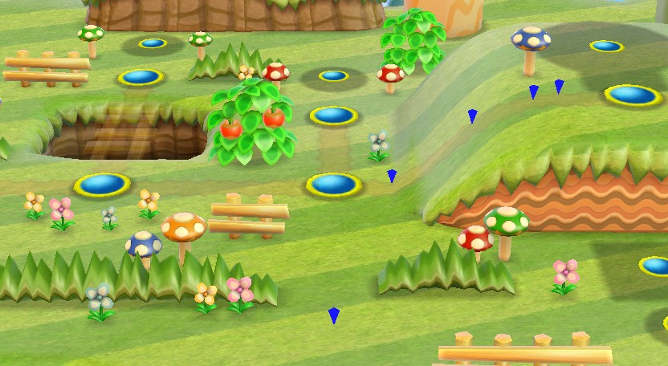
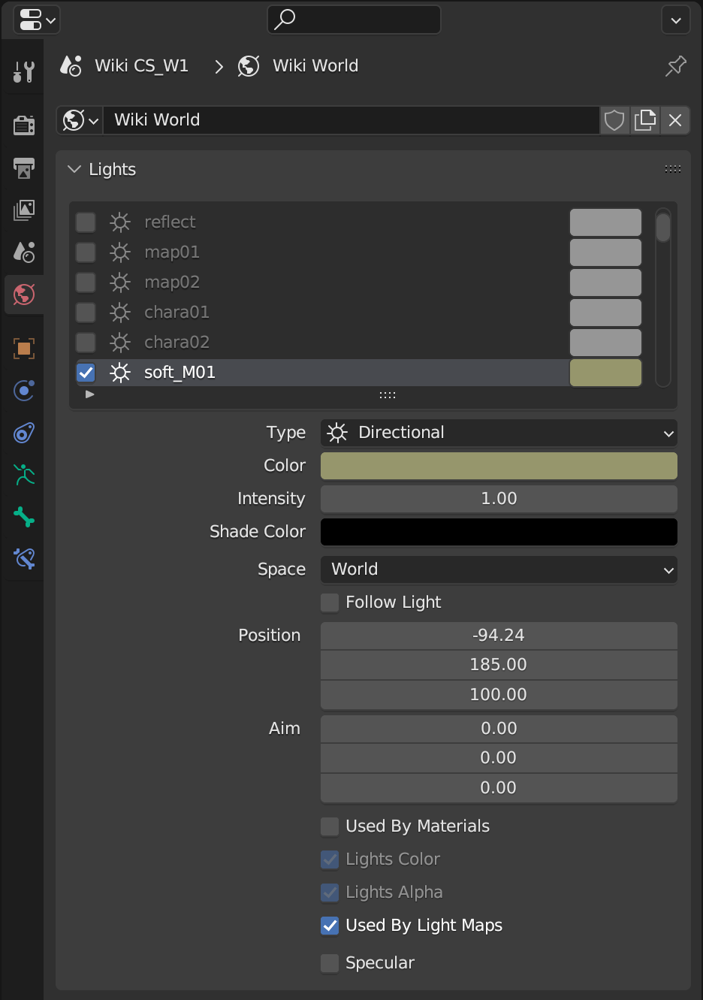
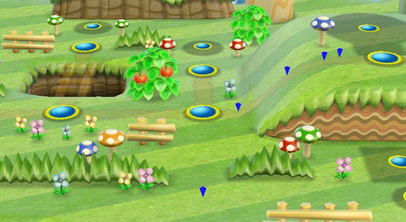
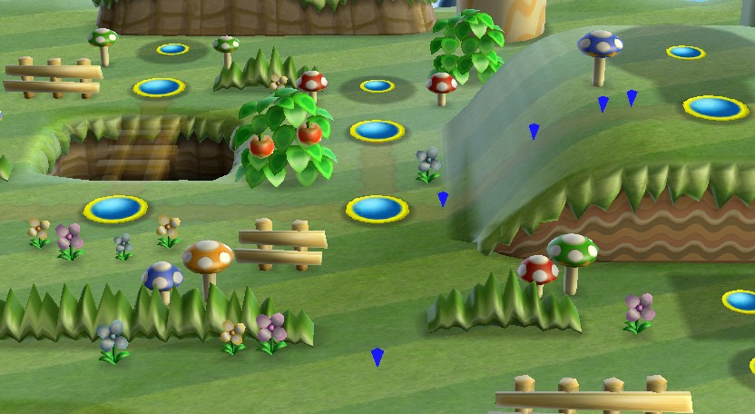
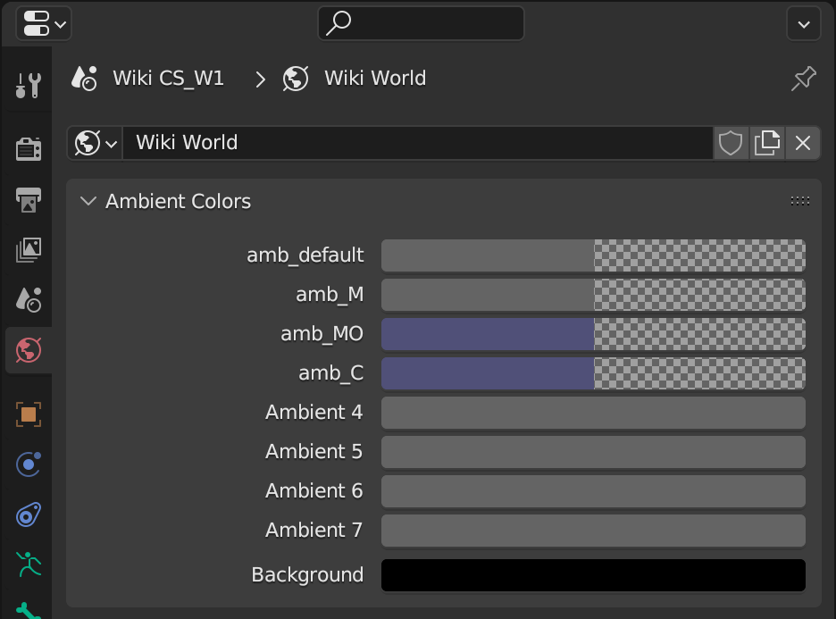
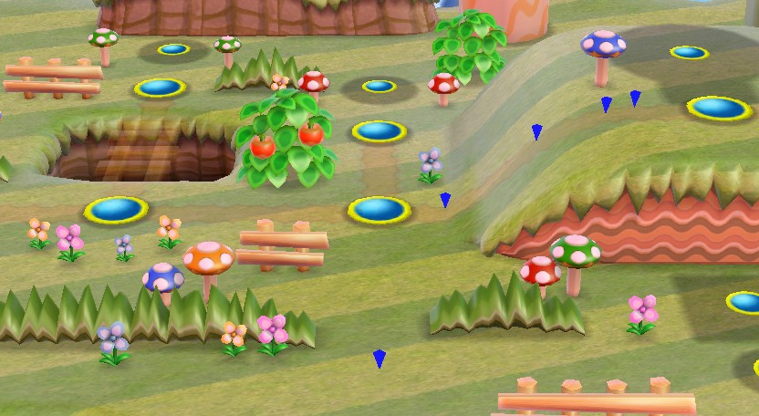

# Introduction

The `.blight` file of a lighting set holds the **lights** and **ambient colors** of a scene. Lights get used in two different ways:

- By [[ light maps | Light-Maps ]]. The game draws the lights into the light map textures, which most models of the game use for their shading. This is by far the most common use.
- By materials, through their [[ light sets | Light-Sets ]] and lighting channels.

Each light has a name from the scene file, such as `soft_M01`. In the base game, these names tell you what the lights are for: the `soft_M` lights are drawn into the light maps of the map, the `soft_MO` lights into those of map objects, and the `soft_C` lights (or `soft_P`, `soft_E`, `soft_B` and `soft_I` in levels) into those of characters. `main`, `reflect`, `map01`, `map02`, `chara01` and `chara02` are the lights of the light sets.

# Lights

**World Properties > Scene Lighting > Lights** lists every light of the set. The checkbox turns a light on or off, the icon shows its type, and the swatch shows its color. A disabled light is black everywhere.

### Type

**Directional** lights shine in one direction everywhere, which is the direction from their position to their aim. **Point** lights shine from their position in every direction, and **Spot** lights shine from their position toward their aim in a cone. Light maps only use the direction of a light, so the type only matters for materials.

### Color, Intensity & Shade Color

**Color** is the color of the light, and **Intensity** multiplies it. Be careful with intensities above 1: the game's multiplication wraps around past full brightness instead of stopping there, so a color that ends up too bright turns dark.

**Shade Color** is only used by light maps. It's the color that a light map gives the side facing away from this light (see [[ here | Light-Maps#shade--ambient-colors ]]).

### Space

This decides what the position and aim are relative to:

- **World**: they're positions in the level or map.
- **World (Highlight)**: like World, but the light shines along the direction halfway between its own and the camera's. In a light map, this puts the light where a highlight of it would be, which is why most highlight lights use this space.
- **Camera**: they're relative to the camera, so the light moves along with it.
- **From Camera**: the light always shines from the camera into the scene. The position and aim are ignored.
- **Toward Camera**: the light always shines from behind the scene toward the camera. The position and aim are ignored.

### Position & Aim

**Position** and **Aim** are given in game coordinates, where Y points up (unlike in Blender, where Z points up). For a directional light, only the direction from the position to the aim matters, not their distance. **Follow Light** makes a light take the position and aim of another light instead, chosen by its number in the list with **Followed Light**.

### Usage

- **Used By Materials** gives this light to the lighting channels of materials (through their light sets). A light only reaches materials if it's enabled and this is checked. **Lights Color** and **Lights Alpha** decide whether it affects their color, their alpha, or both.
- **Used By Light Maps** lets light maps draw this light. Which light maps draw it, and how, is set up in the [[ Light Maps | Light-Maps ]] panel.
- **Specular** makes the light shine on the second (specular) lighting channel of materials instead of the first one, as a highlight with a shininess of 16.

### Falloff

Spot lights also have a **Spot Function** and a **Spot Cutoff** (half of the cone's angle in degrees), which decide how the light fades out toward the edge of its cone. **No Spot Falloff** leaves this fade out.

Point and spot lights also have a **Distance Function**, **Reference Distance** and **Reference Brightness**, which decide how the light fades over distance: at the reference distance, the light has the reference brightness. The game multiplies the reference distance by the squared distance between the light's position and aim. **No Distance Falloff** leaves this fade out.

None of these matter for light maps.

## Example

These are all from the world 1 map with its `W1` lighting set. `soft_M01` is the main light of the light map `lm_01m`, which most of the map's ground uses. The map objects (like the houses) use `lm_01mo` and its `soft_MO` lights instead, which is why they don't change:

| W1 as in the game | `soft_M01` orange | `soft_M01` moved to the other side |
| ----------------- | ----------------- | ---------------------------------- |
|  |  |  |

For an example of lights on a material, see [[ Light Sets | Light-Sets#example ]].

# Ambient Colors

**Ambient Colors** lists the ambient colors of the set, named after the ambient colors of the scene file:

Ambient colors get used in two places: [[ light sets | Light-Sets ]] multiply the ambient color of lighting channels by theirs, and light maps can start out with one (see **Use Ambient Color** in [[ Light Maps | Light-Maps ]]).

On the world 1 map, `amb_M` is both the ambient color of the light set `map` and the starting color of the light map `lm_01m`. Making it purple tints the whole ground:

| W1 as in the game | `amb_M` purple |
| ----------------- | -------------- |
|  |  |

**Background** is a color that the file stores along with the ambient colors. BerryBush keeps it when saving, but it doesn't affect the preview.
