# Introduction

The appearance of a BRRES object's surface is dependent on its **material**. Materials can determine how things are colored, textured, lit, or affected by one another.

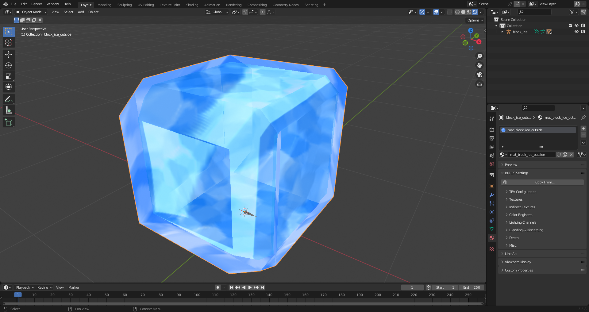

In order to view and edit BRRES materials in Blender, you need to set the render engine of your scene to **BerryBush**. It’s also recommended that you set the View Transform to **Standard** so that colors are displayed accurately. All other settings can be left at their defaults.

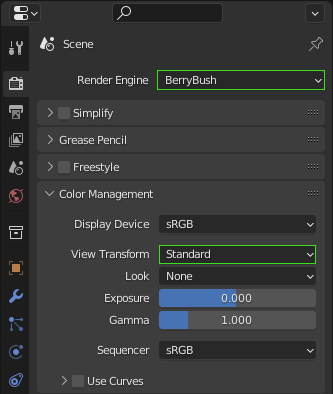

# TEV Configurations

At the core of each material is a **TEV configuration** (called a “shader” in BrawlBox). This determines how the color of each pixel is evaluated by a piece of Wii hardware called the TEV (Texture Environment), based on inputs from the material's other properties. TEV configs can be reused between different materials. They have their own unique names in BerryBush, though these names are not stored in exported BRRES files. You can have unlimited TEV configs in your scene, and you can add, remove, or duplicate them as you like.

## Color Swap Table

The **color swap table** is made up of four rows which define different ways to swap a color’s channels. One of these swap operations can be chosen to be performed each time a color is read from a [[ texture | Materials#textures ]] or a [[ lighting channel | Materials#lighting-channels ]]. Each row has an entry for each color channel which describes which other channel should act as its source.

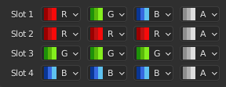

For instance, this swap would map blue to red, red to green, and green to blue:

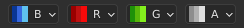

Using this swap on a texture would cause its blue channel to be read for its red channel, red for its green, and green for blue. Here’s an example showing a texture in its original form (left) and after having this swap performed on it (right):

<kbd></kbd>
<kbd></kbd>

Notice how blue becomes red, red becomes green, and green becomes blue.

To keep your input intact, you can use a swap that simply maps every channel to itself:

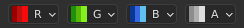

## Indirect Texture Selections

Every material has four [[ indirect textures | Materials#indirect-textures ]] which can be used for texture warping. Each of these textures relies on one [[ ordinary texture slot | Materials#textures ]] for its image data and other settings (e.g., min/mag filter), selected here. This slot is **not** the texture used as the base texture to which warping is applied (that's selected on a per-stage basis).

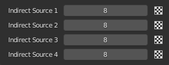

## Stages

At the core of each material is a TEV configuration, and at the core of each TEV configuration is a list of **stages**. Each stage defines one color calculation, and the stages are run sequentially for each pixel on an object being rendered. A stage takes inputs from a variety of sources (including textures, vertex colors, and more), and then performs computations using those inputs to get some output color, which can then be used as an input for another stage (or the final output).

### Selections

This decides the sources for this stage's [[ texture | Materials#textures ]] & raster ([[ lighting channels | Materials#lighting-channels ]] or bump alpha, which is undocumented) inputs and which [[ swaps | Materials#color-Swap-Table ]] to apply when they're read.

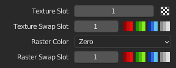

### Indirect Texturing

Each TEV stage can use one [[ indirect texture | Materials#indirect-Textures ]] to distort its main texture before its color is looked up. The settings for this operation can be configured under this panel.

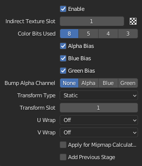

Currently, some indirect texture settings are not documented in BerryBush and may not be reflected properly in the render engine. However, the following features should be fully supported:

You can turn on indirect texturing for a TEV stage by checking **Enable** under the **Indirect Texturing** tab. If this is checked, the texture chosen for indirect texturing will be used to warp the stage's regular texture before it's used as an input. The indirect texture to use can come from one of four indirect texture slots, which are configured in the [[ Indirect Textures | Materials#indirect-Textures ]] material panel and under [[ Indirect Texture Selections | Materials#indirect-Texture-Selections ]].

Optionally, a **bias** value can be added to the value (normalized from 0-255) of each color channel. This bias is -128 by default, but may be different if **Color Bits Used** is set to anything other than 8 (which leads to undefined behavior in BerryBush for now). The only other setting currently that affects rendering in BerryBush is the **Transform Slot**, which determines which [[ indirect texture transform | Materials#indirect-Textures ]] to use.

### Color & Alpha

This is where the actual calculations performed for this TEV stage are determined. Each of the two computations (one for color and one for alpha) takes in 4 inputs, called **A, B, C, and D**. Each of these inputs can take its value from a [[ material color register | Materials#color-Registers ]] or a source for this stage chosen under [[ Selections | Materials#selections ]]. These inputs are all combined in an equation displayed at the bottom of the computation interface, which you can tweak using the other settings.

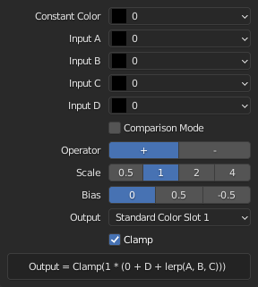

Every TEV stage computation writes its output to one of the four [[ standard color slots | Materials#color-Registers ]]. The last slot with a value written to it is used for the final value, and it's recommended to use slot 1 for this (a rule followed by nearly all models in NSMBW). All TEV configs must have at least one stage.

# Materials

As detailed in the previous section, each material relies on one TEV configuration that determines how its colors are computed. However, these configurations are not typically self-sufficient; rather, they tend to depend on other material features, like [[ textures | Materials#textures ]] or [[ lighting channels | Materials#lighting-channels ]]. Materials also support some additional effects that come after TEV processing. These features are documented below.

## Textures

**Textures** contain images that can be sampled by the TEV stages, along with settings such as wrapping modes that dictate how this sampling should behave.

### Transform

Textures can be transformed via translation, rotation, and scaling. All of these can be animated. The specifics of their behavior are based on one of three potential sets of conventions, selected on a per-material basis. These texture transform modes are as follows:

| Mode    | Rotation                           | Scaling           | Order                          |
| ------- | ---------------------------------- | ----------------- | ------------------------------ |
| Maya    | Clockwise about center             | About bottom-left | Rotation, translation, scaling |
| XSI     | Counterclockwise about bottom-left | About bottom-left | Translation, rotation, scaling |
| 3DS Max | Clockwise about center             | About center      | Translation, rotation, scaling |

"Order" determines how translation, rotation, and scaling affect one another. For instance, Maya translations occur along rotated axes, since translation comes after rotation, while XSI and 3DS Max translations occur along the image's original axes.

Note that a fourth set of conventions also exists, used by [[ indirect texture transforms | Materials#indirect-Textures ]]:

| Mode     | Rotation                        | Scaling        | Order                          |
| -------- | ------------------------------- | -------------- | ------------------------------ |
| Indirect | Counterclockwise about top-left | About top-left | Scaling, rotation, translation |

### Settings

In addition to their images and transforms, textures come with a few other settings that decide how they should be sampled. These include **wrapping**, which determines how textures work with out-of-bounds coordinates, and **filters** for upscaling & downscaling. Many of these features deal with common concepts in computer graphics, and more details on these topics can be found online (in addition to the descriptions within BerryBush). There are also several settings that are only applicable when [[ mipmapping | Materials#mipmaps ]] is used, and a few references to SCN data. Because of BerryBush's current limitations, some of these options are not yet reflected in the render engine, but editing them is fully supported.

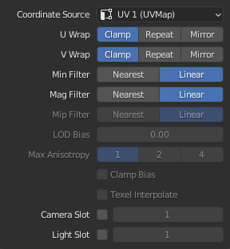

The last setting to cover is the **Coordinate Source**, which determines how a texture actually gets mapped onto a surface. This can be from one of eight [[ UV maps | Materials#mesh-settings ]], or a few other options that base the texture's mapping on camera or light positions. Again, because of the BerryBush's current limitations, these other modes may not display with complete accuracy, but they should provide a rough idea of how the texture will be mapped.

### Images

It’s important to note that while a “texture” is an entry in the Textures list that can be referenced by a TEV configuration, an “**image**” is an image file loaded into Blender. Images are used by textures. An image can be used by one or multiple textures.

Each texture has a list of images and an active entry within that list which is the image that should be used for rendering. The active entry is animatable, which means that you can use animations to swap out different images for the same texture (useful for effects such as changing facial expressions). This can all be configured under the **Animation Slots** tab.

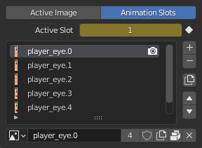

The active image can be edited in greater detail under the **Active Image** tab. Here, you can set the image’s [[ format | Materials#image-formats ]] or configure its [[ mipmaps | Materials#mipmaps ]]. If you don’t need image swapping animations, you can ignore Animation Slots and use this tab exclusively, as it should have everything you need.

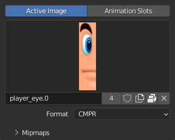

It is **strongly recommended** to ensure that your images' dimensions are always **powers of two**. Images that violate this rule may seem fine in Dolphin, but will not render properly on console if wrap modes other than **Clamp** are used. Additionally, it’s recommended to keep texture sizes as small as possible. The **maximum size allowed is 1024** on both axes, but the base game rarely goes this high. Images that exceed this size are rendered as pure black by BerryBush, but display on Dolphin or on console is undefined.

#### Mipmaps

**Mipmaps** are optional smaller representations of an image which can be used when rendering it at a low resolution (such as when viewing from far away), rather than downscaling it directly, to combat aliasing and improve performance. Each of an image’s mipmaps should be exactly half the size of the previous mipmap on both axes, the first entry being half the size of the original image. BRRES formats and other settings for mipmap images are disregarded (**only the base image's settings are used**).

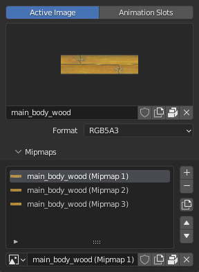

You can provide as many mipmaps for an image as you like, as long as there are no gaps in the chain (e.g., going straight from 32x32 to 8x8 without a 16x16 entry in between; this 16x16 entry would simply be filled with black).

#### Image Formats

Images can be stored in 8 different formats, all with their own strengths and weaknesses for balancing file size and visual quality:

| Format | Bits Per Pixel | Description                                                                                  |
| ------ | -------------- | -------------------------------------------------------------------------------------------- |
| I4     | 4              | Intensity (one value for red, green, blue, & alpha) with 4 bits of precision                 |
| I8     | 8              | Intensity (one value for red, green, blue, & alpha) with 8 bits of precision                 |
| IA4    | 8              | Intensity (one value for red, green, & blue) & alpha with 4 bits of precision each           |
| IA8    | 16             | Intensity (one value for red, green, & blue) & alpha with 8 bits of precision each           |
| RGB565 | 16             | Red, green, and blue with 5/6/5 bits of precision respectively (alpha always 1)              |
| RGB5A3 | 16             | Red, green, blue, & 3-bit alpha with 5 bits of color precision when alpha = 1 or 4 otherwise |
| RGBA8  | 32             | Red, green, blue, & alpha with 8 bits of precision each (best quality, worst size)           |
| CMPR   | 4              | Red, green, blue, & binary alpha stored using DXT1 compression                               |

The format chosen for an image is reflected in the BerryBush render engine. It is **not** reflected in the image preview, which shows the image's original form. This is demonstrated in the following example, which shows an image converted to the IA8 format (and therefore converted to grayscale) in the viewport but kept intact in the material UI:

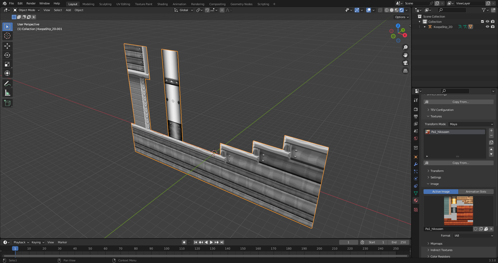

## Indirect Textures

An indirect texture is a texture used to distort another texture. Most commonly, indirect textures store pixel offsets in their blue & alpha channels, and these offsets are used to apply transformations to images that would otherwise be unattainable (for effects such as rippling water or smoke).

**Warning:** Currently, some indirect texture settings are not documented in BerryBush and may not be reflected properly in the render engine. As such, the following explanation is overly simplified and may not be entirely accurate. Proceed with caution.

Indirect texturing involves two textures, which we'll call the **indirect texture** (which stores warping information) and **base texture** (which gets warped). One indirect texture can be used with multiple base textures, and vice versa. When an indirect texture is read, its colors are normalized to a range of 0-255. These values are then added to a **bias** (usually -128, configured under the TEV stage [[ Indirect Texturing | Materials#indirect-texturing ]] panel), and then they're transformed by one of three **Indirect Texture Transforms** (also selected there, but configured here under **Transforms**). The resulting alpha value is taken as an offset in pixels applied to the base texture on the U axis, positive values corresponding to **rightward** texture movement. The blue value is used similarly for the V axis, positive values corresponding to **downward** texture movement. The green value is read before the transformation is applied, and taken as a **scalar by which its translation is multiplied**. (Therefore, if the translation is 0, the green channel is entirely unused). Since only the blue & alpha channels are typically used, the intensity-based color formats are well-suited for indirect texturing.

For example, an indirect texture which has a value of 129 for every color channel on every pixel, and all biases set to -128, will offset the base texture by 1 pixel on both axes. This offset can be translated, rotated, or scaled by an Indirect Texture Transform, whose translation will be multiplied by 1.

Each material has **four indirect texture slots**. Each slot relies on one ordinary [[ texture slot | Materials#textures ]] for its image data and other settings (e.g., min/mag filter). This slot is **not** the texture used as the base texture to which warping is applied (that's selected on a per-stage basis). The source for each indirect texture is configured under the TEV config's [[ Indirect Texture Selections | Materials#indirect-texture-selections ]]. In addition to this, each slot has a mode of distortion and corresponding light slot (currently undocumented and unused in BerryBush for rendering, but can still be set), as well as a scaling to be applied on each axis before the indirect texture is looked up.

In the following example, indirect texturing is used to offset the center of a texture to the left and up:

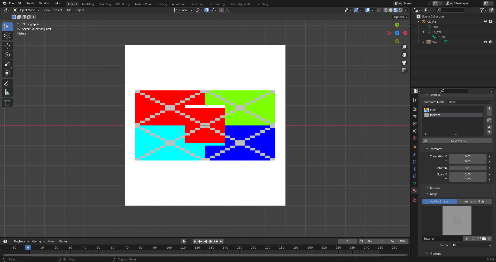

In this more advanced example from NSMBW's World 4 map, it's used to create water effects:

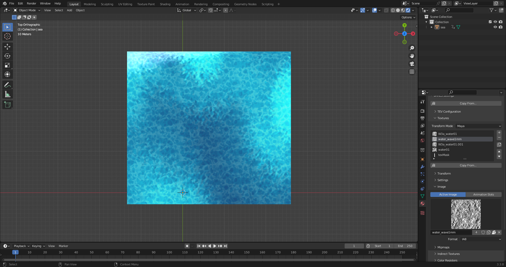

This is then combined with animated [[ texture transforms | Materials#transform ]] to make the water shimmer and flow in ways that seem sophisticated and complex, but really just rely on a little bit of indirect texturing.

## Color Registers

The **color registers** are 8 slots for storing colors that can be used as inputs for TEV computations. Four of these slots (the **Standard** slots, as opposed to **Constant**) can also be used as outputs. 7 of the 8 slots can be animated or set to fixed values, with the exception being the **first standard slot**. This slot may be altered by the TEV stages, but begins with an undefined value on console (white on Dolphin). This slot is recommended to be used for the final TEV output.

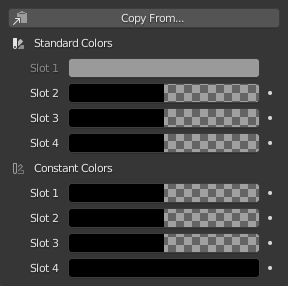

## Lighting Channels

**Lighting channels** provide access to vertex colors, as well as SCN light data, for use in TEV stages. A material can have up to two of these, each associated with one [[ color attribute slot | Materials#mesh-settings ]]. The color produced by a lighting channel is equivalent to its **diffuse** color, optionally multiplied by its **ambient** color if the **Diffuse Lighting** checkbox is checked. Each of these colors can either come from the light channel's corresponding vertex attribute, or an animatable register if enabled.

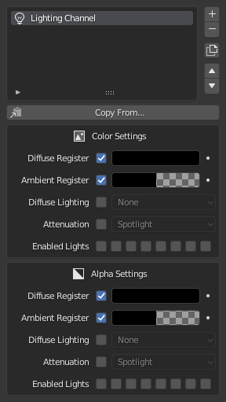

Like indirect textures, lighting channels are not fully utilized in NSMBW, and this is an overly simplified description that may not be accurate in all cases. All of their settings can be edited and imported/exported, but many are not yet documented in BerryBush and may not be reflected properly in the render engine. Use with caution. How lighting channels receive the lights and ambient colors of the scene is described in [[ Light Sets | Light-Sets#using-a-light-set-in-a-material ]].

## Blending & Discarding

We've seen how to set the color and alpha of a surface, but that alpha doesn't actually do anything on its own. One way to use it is with **blending**, which lets you adjust the color of a fragment (pixel on the screen) based on its alpha and the color already in the framebuffer when it's drawn. The default settings allow for interpolation between the source color (color being drawn) and destination color (color already drawn) based on the source alpha, which creates traditional translucency, but you can tweak the blending function and factors for more effects. Note that when blending is enabled and objects overlap, you might get different results depending on which is drawn first. Because of this, it may be useful to manipulate their drawing order through the **Translucent Render Group** checkbox, which allows you to force some objects to draw after others. For more control, you can also manage the objects' [[ draw priorities | Materials#mesh-settings ]].

Alternatively, you can also blend using a **logical operation**, applied between the source and destination colors' binary representations. This panel also includes a few options for discarding fragments altogether, such as **culling**, which allows you to disable the drawing of certain face sides. There's also the **alpha test**, which gets rid of fragments whose alpha values don't match certain conditions. The last documented feature under this panel is **dithering**, which is an optional effect that uses noise to allow for smoother color transitions. All other settings currently have no effect on rendering in BerryBush, because they're unused in NSMBW and further testing is required. However, editing and importing/exporting them is still fully supported.

**Warning**: Using blending factors involving **Destination Alpha** or enabling the **Constant Alpha** setting only works for certain framebuffer formats. The BerryBush render engine always allows for these settings, but in some cases, they might not be supported ingame.

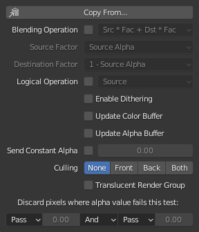

## Depth

The **depth** buffer is used to determine which fragments (pixels on the screen) should go in front of one another. Specifically, this is utilized in the **depth test**, which can use one of eight **functions** to determine whether to draw or discard a fragment based a comparison of its depth to the value currently in the buffer (which starts at 1, and then gets updated with lower values as fragments are drawn). Therefore, if the depth test is enabled and the function is set to `<` or `<=`, fragments will not be drawn if they're behind other fragments that have already been drawn to the screen, which makes this the desired setting in many cases (though not always - for instance, you may want to disable the test if utilizing blending). Writing to the depth buffer can optionally be disabled.

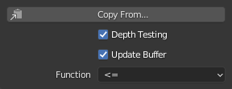

## Misc.

This is where a material picks its [[ light set | Light-Sets ]] and its [[ fog set | Fog ]]. Both are reflected in the render engine while a [[ lighting set | Scene-Lighting ]] is loaded.

# Mesh Settings

In addition to the settings stored in TEV configurations and materials, a few extra options are stored on a per-mesh basis.

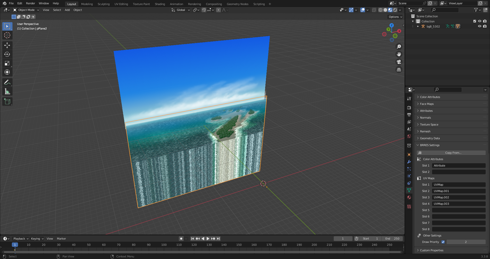

Blender supports two distinct types of geometry attributes: generic attribute layers and UV maps. BRRES also supports two distinct types of geometry attributes, with room for up to 2 color attributes (used by [[ lighting channels | Materials#lighting-channels ]]) and 8 UV maps (used by [[ textures | Materials#textures ]]). Here, you can select **which Blender layers should correspond to which BRRES slots**. Both types of Blender attributes can be used for either type of BRRES attribute (e.g., you can use a UV map for a BRRES color attribute, a generic layer for a BRRES UV map, etc.). However, name collisions are possible between generic attributes and UV maps (though Blender itself discourages this), so generic attributes are prioritized for color attributes, while UV maps are prioritized for UV maps.

There's one other setting that can be configured on a per-mesh basis: **draw priority**. Combined with materials' [[render groups | Materials#blending--discarding]], this is used to determine the order in which objects should be drawn. A higher priority means that an object should be drawn later, though render group takes precedence over this. If two objects are in the same render group with the same draw priority, then their relative order is arbitrary. The draw order primarily matters for objects with materials that utilize [[ blending | Materials#blending--discarding ]], and controlling it is often required in cases where these objects overlap with others.