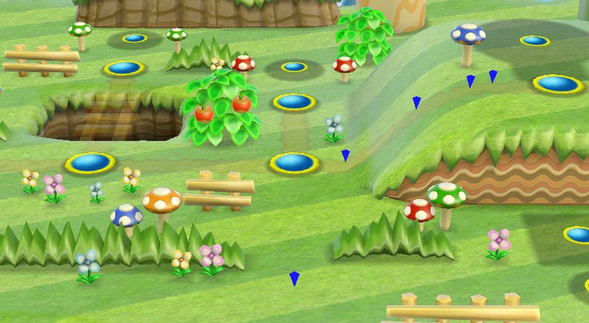
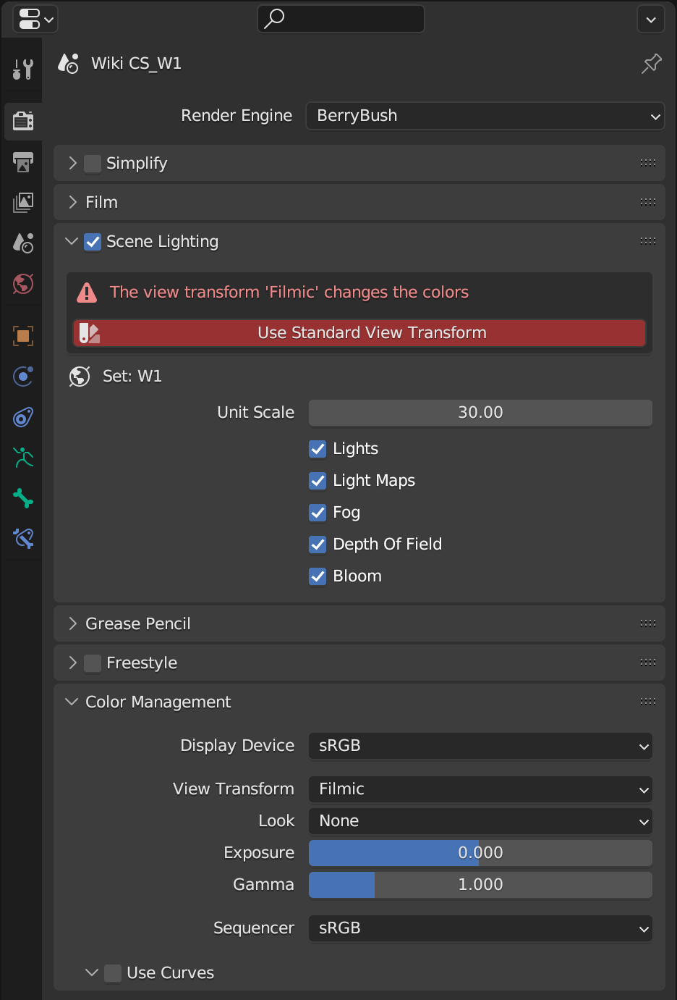
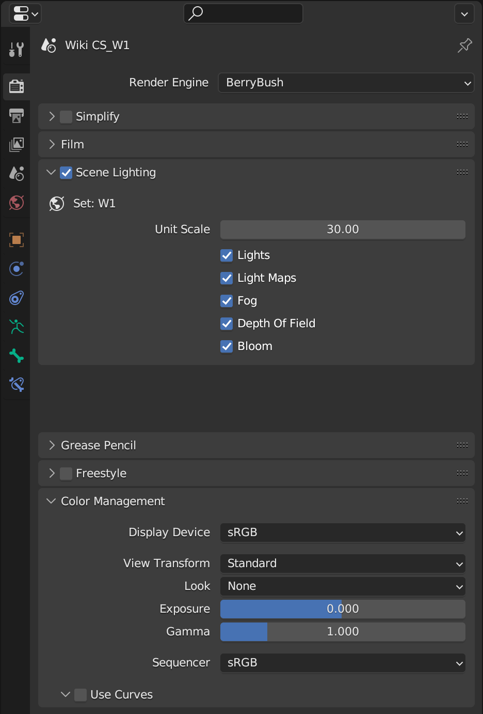
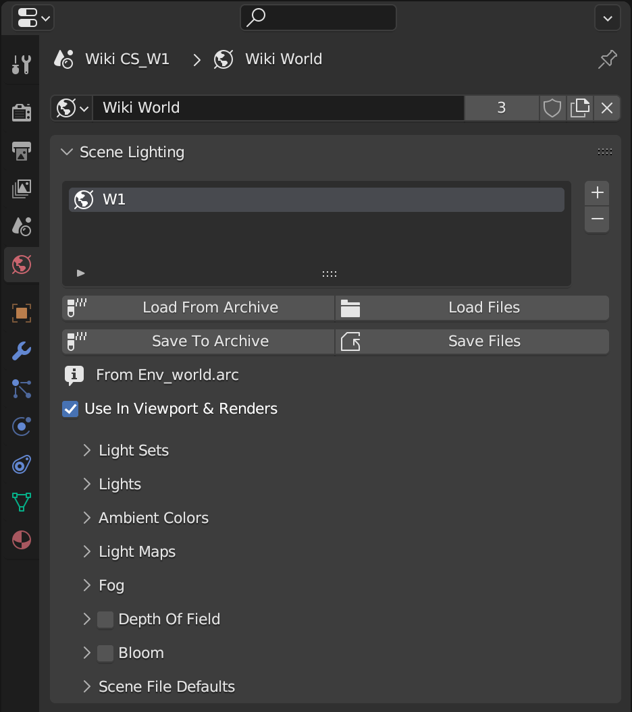
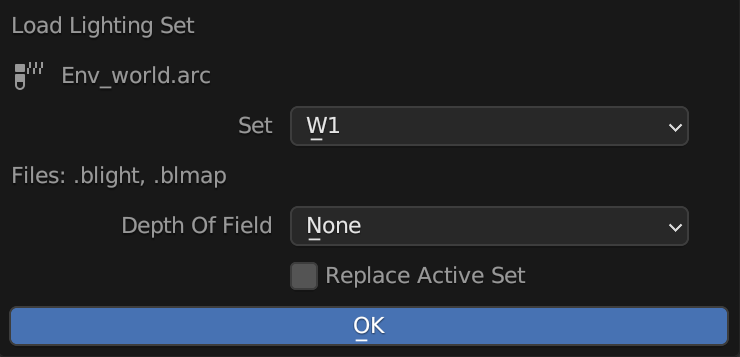
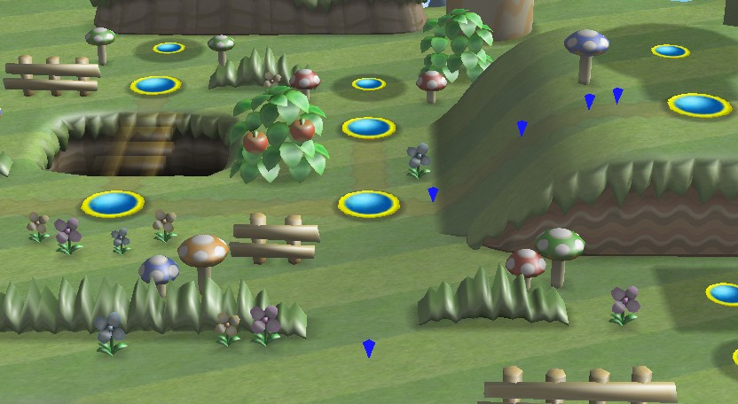

# Introduction

Models in NSMBW don't light themselves. Every scene the game draws (a level, a world map, a cutscene) loads a **lighting set**: a group of files from the game's `Env` folder which decides how the lights, the lightmaps, the fog and the post effects of that scene look. These files belong to EGG, the engine NSMBW is built on.

BerryBush can load these lighting sets from the game's archives, edit every setting in them, show your models with them in the viewport and in renders the way the game draws them, and save them back. This means you can see exactly how a model will be lit ingame without leaving Blender, and you can make lighting of your own.

A lighting set is made up of these files:

| File | Contents | Guide |
| ---- | -------- | ----- |
| `scene/scene.brres` | The **light sets**, which group lights for materials (one file shared by every lighting set of an archive) | [Light Sets](Light-Sets) |
| `light/<Set>.blight` | The **lights** and **ambient colors** | [Lights](Lights) |
| `light/<Set>.blmap` | The **light maps**, textures the game draws from the lights | [Light Maps](Light-Maps) |
| `fog/<Set>.bfog` | The **fog** | [Fog](Fog) |
| `dof/<Name>.bdof` | The **depth of field** (optional) | [Depth Of Field](Depth-Of-Field) |
| `bloom/<Set>.bblm` | The **bloom** (optional, needs a code mod) | [Bloom](Bloom) |

The base game keeps its lighting sets in three archives:

| Archive | Used by | Lighting sets |
| ------- | ------- | ------------- |
| `Env/Env_course.arc` | Levels | One for each theme, such as `MainScene`, `ChikaScene` (underground) or `SabakuScene` (desert) |
| `Env/Env_world.arc` | World maps | `W1` to `W9`, plus `MainSelect` and `Layout3D` |
| `Env/Env_movie.arc` | Cutscenes | `demomovie` and `demomovie_end` |

Levels pick their lighting set by the theme of each zone, and every world map loads the set of its world (`W1` for world 1, and so on). Depth of field files are the exception: a level picks `SabakuDepth`, `WaterDepth` or `KoopaDepth` depending on the stage rather than the lighting set, so a `.bdof` isn't named after a lighting set.

# Setting Up

First, make sure your scene's render engine is set to **BerryBush**, as described in the [[ Getting Started guide | Getting-Started ]].

BerryBush only shows the game's colors with the **Standard** view transform. New Blender scenes use **Filmic** instead, which makes everything paler and flatter (white never goes above roughly 80% brightness), so lighting, fog and bloom will all look wrong with it. As long as the view transform isn't Standard (with the look set to None), BerryBush shows a warning in its lighting panels, along with a button that fixes it:

You can also change this yourself under **Render Properties > Color Management** by setting **View Transform** to **Standard** and **Look** to **None**:

# Loading a Lighting Set

Lighting sets are managed in the **Scene Lighting** panel, which you can find in the **World Properties** tab.

## From an Archive

Click **Load From Archive** and pick one of the game's `Env` archives, such as `Env/Env_world.arc` for the world maps. BerryBush then asks which lighting set you'd like to load:

- **Set** lists every lighting set of the archive, named after its `.blight` file. The line below it shows which files the chosen set has.
- **Depth Of Field** picks a `.bdof` of the archive to load along with the set, or **None**.
- **Replace Active Set** loads the files into the active lighting set instead of adding a new one. This only shows up if your scene already has a lighting set.

If the archive has a scene file (`scene/scene.brres`), its light sets get loaded too.

## From Loose Files

**Load Files** loads files you've extracted yourself into the active lighting set (or into a new one, if you have none yet). You can select several at once: `.blight`, `.blmap`, `.bfog`, `.bdof` and `.bblm` files, as well as a `scene.brres` for the light sets.

## The Lighting Set List

A scene can have any number of lighting sets, which is handy for comparing different ones or keeping several of your own. The active set (the one highlighted in the list) is the one BerryBush draws with. A camera icon next to a set means it has depth of field, and a sun icon means it has bloom. The **+** button adds an empty set, and **-** removes the active one. The name of a set is also the name its files are saved under.

Below the buttons, BerryBush shows which archive the active set was loaded from. **Use In Viewport & Renders** turns the whole scene lighting preview on and off.

The panels below hold the settings of the active set. Each of them has its own guide:

- **Light Sets** and **Scene File Defaults** (`scene.brres`): [[ Light Sets | Light-Sets ]]
- **Lights** and **Ambient Colors** (`.blight`): [[ Lights | Lights ]]
- **Light Maps** (`.blmap`): [[ Light Maps | Light-Maps ]]
- **Fog** (`.bfog`): [[ Fog | Fog ]]
- **Depth Of Field** (`.bdof`): [[ Depth Of Field | Depth-Of-Field ]]
- **Bloom** (`.bblm`): [[ Bloom | Bloom ]]

# Previewing

As soon as a lighting set is loaded, the viewport and renders use it. Here's the world 1 map (`WorldMap/CS_W1.arc`) without scene lighting (left) and with the `W1` lighting set of `Env_world.arc` (right):

<kbd></kbd>
<kbd></kbd>

Most of the difference comes from the lightmaps. Every texture whose image is named like one of the set's light maps (such as `lm_01m`) shows the light map BerryBush generates instead of its image, just like the game replaces these images while it's running. This means you don't need to dump lightmaps from Dolphin anymore to see your models properly. (A suffix like `.001`, which Blender adds to duplicate image names, is ignored for this.)

The **Scene Lighting** panel of the **Render Properties** tab (shown in [[ Setting Up | Scene-Lighting#setting-up ]]) controls the preview:

- The checkbox in its header is the same as **Use In Viewport & Renders**.
- **Unit Scale** is the number of game units that one Blender unit stands for. Set it to the scale you imported your models with (if you kept to the recommended values, that's 16 for most models and 30 for world maps). The distances of fog and depth of field and the positions of lights are all given in game units, so they only line up with your scene if this is right.
- **Lights**, **Light Maps**, **Fog**, **Depth Of Field** and **Bloom** turn the parts of the preview on and off one by one, which makes it easy to see what each of them does.

# Saving

**Save To Archive** writes the active set into an archive. The file browser starts out with the archive the set was loaded from, and its side panel has two options:

- **Depth Of Field Name** is the name the `.bdof` is saved under (by default, the one that was loaded), since the game doesn't pick it by the name of the set.
- **Write Light Sets** also writes the scene file with the light sets. Keep in mind that every lighting set of an archive shares this file.

The files of the set replace the files with the same names in the archive, and everything else in the archive stays as it was. To save a set under a new name (for instance, to add a lighting set for a new world map), rename it in the list first.

**Save Files** writes the files of the set next to each other instead (plus `scene.brres`, if the set has light sets), in case you'd rather put them into an archive yourself.

Loaded files keep everything that BerryBush has no setting for, so a set that you load and save again without any changes comes out identical to the original.

# Limitations

- In the game, depth of field is drawn right after the backgrounds, so it only ever blurs those. BerryBush blurs everything by its distance instead. More details are available [[ here | Depth-Of-Field ]].
- The heat haze of depth of field files isn't shown.
- NSMBW can't load bloom on its own. More details are available [[ here | Bloom ]].
