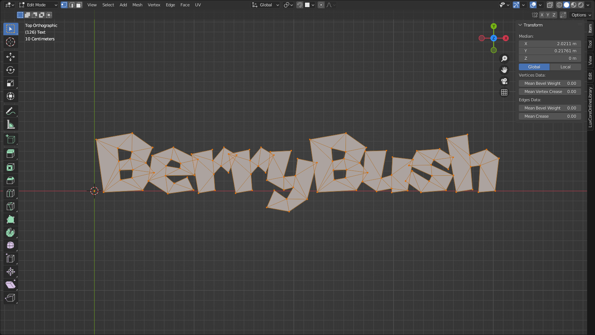

**Note**: If you were sent here by another wiki page and aren't yet familiar with the BRRES format, don't worry too much about anything that you don't understand. Feel free to jump around here and come back later. After your first skim of this page, proceeding to [[ Installation | Installation ]] and [[ Getting Started | Getting-Started ]] is recommended.

# Introduction

<!--  -->

This tool aims to provide an alternate workflow for NSMBW model editing, due to a lack of stability or straightforwardness in existing tools that were never created with this game in mind (namely, BrawlBox/BrawlCrate). However, though it may sometimes function as a full-on replacement for those tools, this will not be true in all cases. Conversion between Blender models and BRRES models is not a direct process in either direction, and while BerryBush aims to be the best tool suited for this conversion for NSMBW, BrawlCrate is still very handy for examining the precise contents of BRRES files throughout the process (just as long as you don't save any changes). Using both tools to verify one another is always recommended.

That said, BerryBush is a cross-platform addon for **Blender 3.3 LTS**. It's also known to work with **Blender 3.4**, though this may be less stable. Other versions are currently not supported. (Blender 3.5+ support is planned eventually, but not any time soon)

# Current Limitations

- Models containing multiple bones with the same name cannot be imported, and must first be fixed in an external tool such as BrawlCrate (note that this only pertains to custom models, as there are no vanilla models with this property)
- Certain material features (especially those that relate to indirect texturing) are not properly documented or reflected yet in the render engine
- Only the BRRES sub-file versions used in NSMBW are supported (11 for MDL, 3 for TEX, 3 for PLT, 5 for CHR, 4 for CLR, 4 for PAT, 5 for SRT, and 4 for VIS)
- The SCN sub-file format (used in 3 files in NSMBW's `Env` folder) and SHP sub-file format (unused in NSMBW) get ignored on model import. The light sets of the SCN files in the `Env` folder can be edited as part of the [[ scene lighting | Scene-Lighting ]] instead
- Fur (unused in NSMBW) is unsupported, and gets ignored on import
- Models using XSI bone conventions (unused in NSMBW) cannot be imported or exported
- Little-endian BRRES files (unused in NSMBW) cannot be imported or exported
- Bounding box information is not exported
- Exported CHR & SRT animation data (particularly CHR) is often larger than necessary (optimizing this is a constant work in progress)
- Import & export can be slow, complex CHR animations being the #1 culprit (again, a constant work in progress)

The file size issues are particularly important, as they make models take up more space than needed in the Wii's limited memory. Make sure to keep size in mind at all times. Export options such as [[Merge Files|Export-Options#merge-files]] can be used to help with this.

## Exporting Complex Rigs

Due to the complexity of Blender's rigging system and the limits of the BRRES format, export of bone animations can be fundamentally lossy in certain cases. More info on this topic is available [[ here | Animations#chr ]].

## Notes About Lighting

This topic is described in depth in the [[ Getting Started guide | Getting-Started#importing-lightmaps ]]. Here's a brief summary:

Lighting effects in NSMBW are primarily achieved through vertex colors and special lightmap images. These lightmap images are generated while the game is running, based on parameters defined within files in the game's `Env` folder (all part of an engine called EGG on which NSMBW is based). BerryBush can load, edit and save these lighting files, and preview them the way the game draws them, as described in [[ Scene Lighting | Scene-Lighting ]]. It also allows you to take advantage of the lightmaps via the same means used in vanilla models.

All that you have to do is give certain names to your models' images and NSMBW will overwrite them at runtime with the corresponding lightmaps. These names and their uses are documented in [[ an image on the Horizon wiki | https://horizon.miraheze.org/wiki/File:Lightmap_Documentation.png ]]. (The numbers before each name, as well as their extensions, can be disregarded; for instance, to use the first background lightmap, simply name your image `lm_01m`). If this seems confusing, try importing some models from the base game and checking out their setups.

Note that since the lightmaps are replaced at runtime, the lightmap images used in retail models are simply placeholders, and they generally don't look too great. Often, they wash out the colors or have wacky highlights, and one even has the letters "obj" written on it. Once you load a [[ lighting set | Scene-Lighting ]], BerryBush generates the real lightmaps and shows them in place of these images. Because these are just placeholders, you can replace them with whatever you like. If you want to replace them with actual lightmaps from the game, you can dump them using Dolphin with **Graphics > Advanced > Dump EFB Target**. This will extract (among other things) the images generated by the game (in the order from the image linked above - `lm_01` first, then `lm_02m`, then `lm_01mo`, etc.), which should help make your models look a little nicer in Blender.